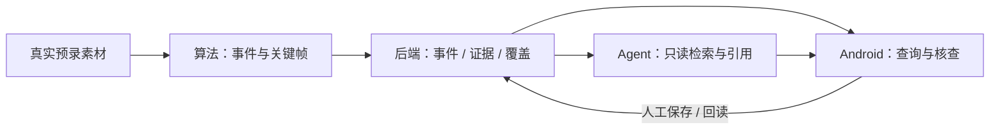

# ParTrace Vision · 驿站追迹

**不盯屏，也能看清驿站每一天。** 面向驿站管理员的 AI 事件溯源助手。

**首版存储采用 PostgreSQL + pgvector，业务数据与事件向量同库分表。** 图片和视频保存在文件或对象存储中。

**主端采用 Android：Kotlin + Compose，复用官方 KMP/Compose 示例。** 官方 App SDK 提供事件查询、缩略图、回放、下载及设备控制，适合首轮取证与核查；Web 桌面查阅放到后续。

**服务端统一 Python：Backend 使用 FastAPI，Agent 以独立 Python 包接入同一 API 应用，Vision 使用独立工作进程。** 本地 Backend 提供原有 14 个数据操作及 7 个 People 原片任务操作；显式启用 Agent 后再挂载 9 个，共 30／35，P1 包裹 5 个仍待开发。当前契约为 12 表／106 字段，development 媒体使用受限本地文件存储。

**2026-10-17 开发整合版：** 本次把 Android 界面与设备接入、People 原片管线、Vision worker、Agent 客户端与 Skill、增量迁移和部署脚本整理到同一源码版本，保留最新 dev 的 shelf_level、person_id 与 cards/SSE。整合副本已执行 Backend/Agent 401 项、Vision 103 项、Android 34 项目标测试及构建/lint；完整环境、源码／云端差异和未完成边界见[版本说明](docs/releases/DEVELOPMENT_20261017.md)。
- 真实 SDK A 原片已完成 App 下载、上传、CPU 算法处理及 completed 回读，产出匿名局部轨迹与内部选帧；A 不产区域动作事件。B 原片已排队，等待现场标定／区域映射。此前本地记录中 13 项任务为 1 completed、12 queued，见 [原片先入库后解析](openspec/changes/d06-people-recording-pipeline/verification.md#先入库后解析--2026-10-17-最新验证)。
- Android 已接 Agent API，外部 Chat 模型已实测生成可确认计划；后续运行出现执行失败／超时，Embedding 尚缺配置。真实区域事件的引用、人工核查保存与 D10 闭环仍待验收，见 [Android Agent 验证](openspec/changes/d07-android-agent/verification.md)。
- Agent 新增三个内置 Skill 及 `load_skill`，接通受限工具流程、语义不可用后的普通查询与明确披露；此前 Skill 独立离线测试 280 项通过，108 项数据库集成测试未选择；本次整合版另执行上述全量回归。见 [Skill 调用说明](agent/README.md#skill-发现与调用)和 [本次验证](openspec/changes/archive/2026-10-17-d07-agent-skills/verification.md)；外部模型及真实事件闭环仍待验收。

**AWS部署补充（2026-10-17）：** 公网HTTPS已接入Aurora；真实门铃A历史原片与新自动People事件已完成入库、Vision解析和App完成回调，球机B自动原片已排队待标定。A worker当前在本机CPU运行，App需前台及SDK登录。见[云端实测ID与边界](openspec/changes/d06-people-recording-pipeline/verification.md#aurora-公网与真实自动事件2026-10-17)和[Aurora查询SQL](infra/people-aurora/verify-recordings.sql)。上方本机计数属于此前快照，不代表当前云端实时数据。

## 工作台与资料

- [设计文档总入口](docs/README.md)：[全部业务模块与 DB／API 关联](docs/modules/README.md)、数据库、API、P1 包裹方案与开发计划。
- [在线工作台：原型、模块、API 与数据库](https://yizhan-trace-workbench.vercel.app/)
- [最新离线工作台 HTML](docs/workbench/index.html)：原型、开发模块、流程和数据库设计，下载此文件双击即可打开。
- [首轮开发计划：D01–D10](docs/DEVELOPMENT_PLAN.md) · [GitHub 任务](https://github.com/SUertee/partrace-vision/issues)
- [按模块查看 API](docs/api/api-canvas.html) · [最小 API 草案](docs/api/API_DESIGN.md) · [数据库与原片任务](docs/database/README.md) · [离线关系图 HTML](docs/database/schema-canvas.html)
- [开发协作规范：AGENTS.md](AGENTS.md)
- [OpenSpec：安装、规格与开发流程](docs/OPENSPEC.md)
- [产品 PRD](https://q0ef12ao819.feishu.cn/wiki/QHVvwxixBiJspmkoBD1cuU6InQc) · [技术方案](https://q0ef12ao819.feishu.cn/wiki/RFLWwHFplicxpIk10bbcTBr6nqr) · [飞书任务看板](https://q0ef12ao819.feishu.cn/wiki/D3cnwFQJTijUYQkyqaIc0HhjnYf)

工作台中的数据和 AI 回答是模拟样例。2026-10-14 曾同步并核对 Vercel 静态版本，包含当时的用户流程、服务选型、数据库与 API 草案、关系图同比缩放，以及 P1 包裹扫码入出库模块。此后本地契约已更新，当前内容以仓库文件为准；本轮未重新核验线上版本。静态发布不部署业务 API 或数据库。

## 首轮做到什么

固定摄像头、固定区域、少量受控人物，先使用真实预录素材跑通：

**输入问题 → 检索候选事件 → 查看可见路线与关键帧 → 管理员核查保存 → 重启后回读。**

先完成事件和证据闭环。订单关联、扫码入出库、跨镜关联及 Web 查阅后做。SDK 验证独立推进，不阻塞预录素材开发。

## 四人分工

| 主责 | 负责什么 | 先交付什么 |
| --- | --- | --- |
| 李果钦 · Android 前端 | 首页／AI／我的三入口、查询与证据联动、Agent 页面、核查与记录 | 可安装 App 骨架，页面先接共享样例 |
| 徐泽华 · 算法 | 受控素材、匿名跟踪、区域事件、真实关键帧 | 视频、ROI 和人工时间基准，再交事件包 |
| 韩广宁 · Agent | 问题转计划、只读工具、引用结果、运行控制 | 可调用服务、计划及工具调用样例 |
| Harry Xu · 后端 / SDK | 协议、事件/证据/覆盖接口、核查持久化、SDK 与联调 | 统一 JSON 和接口样例；另做真机 SDK 验证 |

## 分支与协作

| 分支 | 用途 |
| --- | --- |
| `main` | 稳定基线与阶段交付版本 |
| `dev` | 四人日常集成与联调 |
| `feat/*`、`fix/*` 等 | 从最新 `dev` 创建的单项任务分支 |

**任务分支 → PR 合入 `dev` → 联调验收 → `dev` 提交 PR 合入 `main`。**

日常开发 PR 的目标分支选 `dev`。阶段交付使用 merge commit 合入 `main`，保留两条长期分支的共同历史。`main` 的所有变更（含文档）必须通过 PR；小型文档或配置修改可按用户已有授权直接提交到 `dev`。分支和提交命名见 [AGENTS.md](AGENTS.md)。

```sh
git fetch origin
git switch dev
git pull --ff-only origin dev
git switch -c feat/d08-evidence-view
```

上面的任务分支名为示例，按自己的工作包替换。`main` 已启用保护：必须通过 PR，管理员同样适用，禁止强推和删除，合并前须解决所有讨论。审批数要求为 0，未配置必需 CI 检查；`dev` 保持日常开发使用。分支命名和本地验证仍属于协作约定。

## 按这个顺序开发

| 阶段 | 任务 | 交付结果 |
| --- | --- | --- |
| ① 先定范围和样例 | D01 | 固定 Demo、统一对象/ID/时间、请求与返回样例 |
| ② 四路并行 | D02–D09；D06 为 SDK 独立支线 | Android 页面、算法事件包、后端接口、Agent 工具；各自先接同一份样例 |
| ③ 同一事件联调 | D10 | 真实事件入库、App 开帧、Agent 引用、人工保存、重启回读及首页简报 |

具体依赖、交付物与验收条件见 [开发计划](docs/DEVELOPMENT_PLAN.md)。每个工作包使用一个 Issue，代码通过 PR 关联；GitHub 任务状态不会自动同步到飞书。



## 仓库结构

```text
android/                 Android 前端
web/                     Mobile Web 用户端（React）
backend/                 后端
agent/                   AI Agent
vision/                  视觉算法
infra/                   Compose 部署与服务器引导（含 Aurora IAM 叠加层）
docs/
  README.md               设计文档总入口
  modules/                业务模块、数据与接口关联
  api/                   接口说明、数据格式与 JSON 样例
  database/              数据库草案与离线关系图
  workbench/             离线 HTML 工作台
  DEVELOPMENT_PLAN.md    开发计划
scripts/                 文档生成、同步与本地配置 / SDK 准备工具
openspec/                行为规格、变更提案与归档记录
```

接口约定见 [docs/api](docs/api/README.md)，由四个模块共同确认；实际接口代码放在各自的开发目录中。

## Backend 与 Agent 本地版本

development 实现保留事件包导入、查询、关键帧、人工保存与回读的 12 个基础操作，并增加向量写入／语义检索两个操作及七个原片任务操作。原片通过 `POST /api/v1/recordings` 的 `mode=source` 先保存 pending 录像与 queued 任务，worker 完整事实与 published／completed 同事务提交；省略 mode 的完整结果包导入保持兼容。`agent/` 使用 `create_agent` 和五个只读工具，不直连数据库；`PARTRACE_AGENT_ENABLED=true` 显式挂载九个 AI 操作，默认关闭。

```sh
cd backend
uv sync --locked
uv run pytest
```

统一安装会带上本地 Agent 包，测试同时覆盖两模块。数据库和私有环境准备、单进程启动见 [Backend README](backend/README.md)，工具与运行边界见 [Agent README](agent/README.md)，内部接口见 [联动说明](docs/modules/BACKEND_AGENT.md)。历史基础验证见 [D05 记录](openspec/changes/d05-backend-mvp/verification.md)与 [D07 记录](openspec/changes/d07-create-agent/verification.md)：真实 PostgreSQL + pgvector 及实际 `create_agent` 图已用于测试，图中使用显式 fake 模型。

[最新原片记录](openspec/changes/d06-people-recording-pipeline/verification.md#先入库后解析--2026-10-17-最新验证)记载 Backend＋Agent 338 项、Vision 101 项通过，Android 原片相关 15 项单测及构建／lint 通过；本轮未重跑。[Android Agent 记录](openspec/changes/d07-android-agent/verification.md#业务边界)另证明真实模型计划成功，后续运行失败且未返回答复／引用／卡片；Embedding model／dimensions／key 未设置，语义服务明确返回 503，尚未证实这是实际失败运行的完整根因。外部模型完整运行、真实 B 区域事件与 Android D10 仍待验收；本地实现不代表已部署或完整产品交付。API key 只保存在私有环境，不发送到聊天或提交 Git。

## Android 开工

工具链沿用官方工程：**JDK 17、Android SDK 36、minSdk 26**。用 Android Studio 打开 `android`。

```sh
git clone https://github.com/SUertee/partrace-vision.git
cd partrace-vision
python3 scripts/setup-android.py --sdk /path/to/ESIotKit-2.2.7.aar
```

脚本从空值模板生成本地配置文件，再安装赛事发放的 SDK AAR；配置文件和 AAR 均被 Git 忽略。按 [Android 说明](android/README.md) 填写自己获授权的本地参数。

```sh
cd android
./gradlew :app:assembleDebug
```

Android 保留用户设计的首页、AI、我的三入口 Compose 界面、独立消息中心与两个浮层，原官方示例保留在「我的 → SDK 调试」。本轮将当前账号的两个真实 SDK 设备直接接入首页，数量随真实列表变化；卡片显示真实名称、状态和最近缩略图，复用原单路直播／设备设置，多画面入口先展示最近缩略图网格。范围见 [d02-station-sdk-devices](openspec/changes/archive/2026-10-16-d02-station-sdk-devices/proposal.md)，上一轮视觉记录保留在 [Android 设计预览](android/design/verification/app/README.md)。

报警尚未接入；AI 追溯已连接现有 Agent API，实现录像／区域、计划确认、运行停止与恢复、结果引用和服务端历史界面，采用轮询，未订阅 SSE。真实模型计划与失败状态已在模拟录像上回读，成功分析与真实事件引用仍待验收，见 [Android Agent 验证](openspec/changes/d07-android-agent/verification.md)及 [Android 说明](android/README.md#agent-api-接入)。本地静音不修改摄像头报警；站点选择仅为界面分组，不对应 SDK 房屋或设备过滤。构建、UI、设备服务与实际摄像头操作分别记录，模拟器连接真实设备不替代 Android 真机检查，也不代表 D06 全部能力或 D10 业务闭环验收。

官方材料限定本次参赛使用，仓库设为私有，来源与使用范围见 [THIRD_PARTY_NOTICES.md](THIRD_PARTY_NOTICES.md)。
