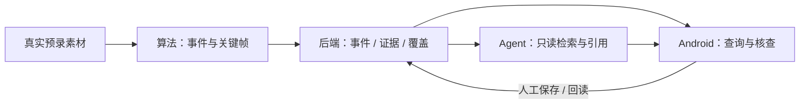

# ParTrace Vision · 驿站追迹

**不盯屏，也能看清驿站每一天。** 面向驿站管理员的 AI 事件溯源助手。

**主端采用 Android：Kotlin + Compose，复用官方 KMP/Compose 示例。** 官方 App SDK 提供事件查询、缩略图、回放、下载及设备控制，适合首轮取证与核查；Web 桌面查阅放到后续。

## 工作台与资料

- [在线工作台：原型、开发模块、开发流程](https://yizhan-trace-workbench.vercel.app/)
- [最新离线工作台 HTML](docs/workbench/index.html)：下载此文件，双击即可打开，无需启动服务。
- [首轮开发计划：D01–D10](docs/DEVELOPMENT_PLAN.md) · [GitHub 任务](https://github.com/SUertee/partrace-vision/issues)
- [产品 PRD](https://q0ef12ao819.feishu.cn/wiki/QHVvwxixBiJspmkoBD1cuU6InQc) · [技术方案](https://q0ef12ao819.feishu.cn/wiki/RFLWwHFplicxpIk10bbcTBr6nqr) · [飞书任务看板](https://q0ef12ao819.feishu.cn/wiki/D3cnwFQJTijUYQkyqaIc0HhjnYf)

工作台中的数据和 AI 回答是模拟样例。线上最新一次更新因 Vercel 授权未通过而暂未同步，当前内容以仓库内离线 HTML 为准。

## 首轮做到什么

固定摄像头、固定区域、少量受控人物，先使用真实预录素材跑通：

**输入问题 → 检索候选事件 → 查看可见路线与关键帧 → 管理员核查保存 → 重启后回读。**

先完成事件和证据闭环。订单关联、扫码入出库、跨镜关联及 Web 查阅后做。SDK 验证独立推进，不阻塞预录素材开发。

## 四人分工

| 主责 | 负责什么 | 先交付什么 |
| --- | --- | --- |
| 李果钦 · Android 前端 | 四 Tab、查询与证据联动、Agent 页面、核查与记录 | 可安装 App 骨架，页面先接共享样例 |
| 徐泽华 · 算法 | 受控素材、匿名跟踪、区域事件、真实关键帧 | 视频、ROI 和人工时间基准，再交事件包 |
| 韩广宁 · Agent | 问题转计划、只读工具、引用结果、运行控制 | 可调用服务、计划及工具调用样例 |
| Harry Xu · 后端 / SDK | 协议、事件/证据/覆盖接口、核查持久化、SDK 与联调 | 统一 JSON 和接口样例；另做真机 SDK 验证 |

## 按这个顺序开发

| 阶段 | 任务 | 交付结果 |
| --- | --- | --- |
| ① 先定范围和样例 | D01 | 固定 Demo、统一对象/ID/时间、请求与返回样例 |
| ② 四路并行 | D02–D09；D06 为 SDK 独立支线 | Android 页面、算法事件包、后端接口、Agent 工具；各自先接同一份样例 |
| ③ 同一事件联调 | D10 | 真实事件入库、App 开帧、Agent 引用、人工保存、重启回读及首页简报 |

具体依赖、交付物与验收条件见 [开发计划](docs/DEVELOPMENT_PLAN.md)。每个工作包使用一个 Issue，代码通过 PR 关联；GitHub 任务状态不会自动同步到飞书。



## 仓库结构

```text
android/                 Android 前端
backend/                 后端
agent/                   AI Agent
vision/                  视觉算法
docs/
  api/                   接口说明、数据格式与 JSON 样例
  workbench/             离线 HTML 工作台
  DEVELOPMENT_PLAN.md    开发计划
scripts/                 本地配置与 SDK 准备工具
```

接口约定见 [docs/api](docs/api/README.md)，由四个模块共同确认；实际接口代码放在各自的开发目录中。

## Android 开工

工具链沿用官方工程：**JDK 17、Android SDK 36、minSdk 26**。用 Android Studio 打开 `android/ESIotKit-DemoApp-Android`。

```sh
git clone https://github.com/SUertee/partrace-vision.git
cd partrace-vision
python3 scripts/setup-android.py --sdk /path/to/ESIotKit-2.2.7.aar
```

脚本从空值模板生成本地配置文件，再安装赛事发放的 SDK AAR；配置文件和 AAR 均被 Git 忽略。按 [Android 说明](android/README.md) 填写自己获授权的本地参数。

```sh
cd android/ESIotKit-DemoApp-Android
./gradlew :app:assembleDebug
```

目前入库的是官方示例源码底座和 HTML 原型。尚未完成本仓库的 Android 构建、真机 SDK、真实 AI 或业务闭环验收；实际进度按 Issue 的交付凭据更新。

官方材料限定本次参赛使用，仓库设为私有，来源与使用范围见 [THIRD_PARTY_NOTICES.md](THIRD_PARTY_NOTICES.md)。
