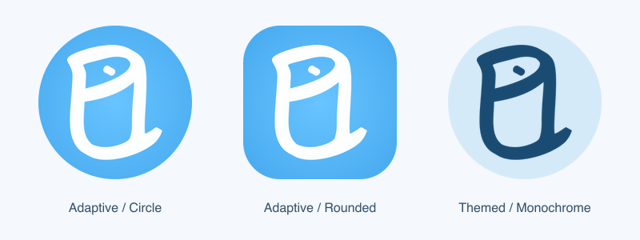

# Android 界面设计与验证

> 工程目录已于 2026-10-17 后续迁移为单一 `android/` 根和 `:core` 模块；下文旧工程名、旧命令与历史产物路径保留当时实际状态，当前使用见 [当前工程与构建入口](../README.md)。

本目录统一保存设计参考和界面验证资料。正式页面的修改位置见 [源码索引](../README.md#页面源码索引)。

| 资料 | 位置与用途 |
| --- | --- |
| 原始设计图与 Logo | [references](references/)，用于核对用户提供的素材 |
| 原生预览与页面截图 | [rendered](rendered/)，每张图的数据来源见下方对应记录 |
| 本次源码与资料整理 | [verification](verification/README.md)，包含实际检查与边界 |
| App 历史界面验证 | [verification/app](verification/app/README.md) |
| Agent 接入与聊天页验证 | [verification/agent](verification/agent/README.md) |

## Agent 对话与共用事件过程

2026-10-17，按用户 P1／P2 参考实现对话与事件详情联动。聊天使用右侧蓝色用户气泡、可展开的真实工具进度、助手正文及淡紫色相关片段；点击片段进入「事件过程」。P3 摄像头事件列表也进入这一详情页，再由用户显式打开摄像头原片。顶部查询范围卡片继续移除，底部来源选择和计划确认保留。

| 页面 | 用户参考 | 本轮原生设计预览 |
| --- | --- | --- |
| 对话与相关片段 | [P1](references/assistant-process-reference.png) | [assistant-conversation.png](rendered/assistant-conversation.png) |
| 事件过程与时间线 | [P2](references/event-process-reference.png) | [event-process.png](rendered/event-process.png) |

两图由 Android Studio Rabbit 1 / 2026.2.1 Compose 渲染并逐张目检：对话为 412×1100dp／1082×2888px，详情为 412×917dp／1082×2407px。预览明确标注模拟数据，只使用同一虚构摄像头、候选事件、缺帧和灰色占位，不初始化 SDK、People 或 Agent。对话使用加高预览框以展示完整内容；正式页面仍按设备高度滚动。未保存 P3 中真实摄像头画面，图片也不代表已安装版本或真实工具执行结果。

正式工具状态来自实际调用生命周期，不读取模型思考或用计划推导完成。详情按受权 Event／Evidence 和精确 SDK 来源关联读取，提供实际关键帧、分页与时间线；没有真实缺口区间、第二摄像头或跨镜关联时，不复制参考图中的示例结论。未发布、缺区域、来源不匹配、缺图和读取失败各自反馈。没有通用后端 MP4 播放／下载功能；已验证的 SDK 记录保留原播放器入口。

源码见 [对话组件](../core/src/commonMain/kotlin/com/anker/esiotkit/sample/main/station/ui/assistant/TraceConversationComponents.kt)、[详情布局](../core/src/commonMain/kotlin/com/anker/esiotkit/sample/main/station/ui/events/StationEventDetailLayout.kt)、[详情连接](../core/src/commonMain/kotlin/com/anker/esiotkit/sample/main/station/ui/events/StationEventDetailScreen.kt)。本轮 Android 52 项相关测试、后端／Agent 453 项离线测试、最终 Debug 构建和 lint 通过；未安装新版、重启服务或进行摄像头／模型／真机联调。命令、凭据边界及待验流程见 [D08 验证](../../openspec/changes/d08-agent-event-detail/verification.md)。

## 移除聊天顶部查询范围卡片

2026-10-17，按用户最新截图删除标题下方整张「新问题的查询范围／SDK 原片／切换」卡片。正文直接接在聊天标题后，底部录像、录像时段、区域入口及计划确认的实际范围仍保留。源码见 [TraceAssistantLayout.kt](../core/src/commonMain/kotlin/com/anker/esiotkit/sample/main/station/ui/assistant/TraceAssistantLayout.kt)。

本轮 `:app:assembleDebug :app:lintDebug` 成功，耗时 1m 8s，lint 133 项 Warning、0 Error/Fatal。Android Studio CLI 在构建中及构建后两次调用 `TraceAssistantIdlePreview` 均返回渲染错误，未产出新图；下节 `assistant-real-sources.png` 为移除卡片前的历史预览，不代表当前布局。未覆盖安装 APK 或操作设备，本轮未运行单元测试，纯展示删减不改变 Agent 数据或执行逻辑。OpenSpec strict、空白、相对链接及五项离线设计同步检查通过。

本机构建日志为 `/private/tmp/partrace-assistant-remove-scope-card-20261017.log`，APK 在 `android/app/build/outputs/apk/debug/app-debug.apk`。UI 实际效果与真机仍待安装后检查；不把编译成功当作设备验收。

## 聊天移除模拟录像来源

2026-10-17，按用户要求，正式对话不再自动选择或提供 mock 录像。已发布 SDK 原片和真实预录继续可选；无来源时显示「选择真实录像后开始提问」，选择器显示暂无可分析的真实录像。

[本轮聊天空态预览](rendered/assistant-real-sources.png) 由 Android Studio 的 `TraceAssistantIdlePreview` 渲染并目检，412×917dp／1082×2407px，无录像、会话或模型调用。它只证明空态布局与文案；来源过滤、本地旧模拟恢复清理与只读历史使用本机测试 HTTP 服务回归，不是生产账号或真机操作凭据。详细结果见 [Android Agent 验证](../../openspec/changes/d07-android-agent/verification.md#正式聊天移除模拟录像2026-10-17)。

## 摄像头检测事件页

2026-10-17，用户确认展示摄像头检测事件后，在当前原生工程增加「事件」根入口。首页、事件、我的共用四项胶囊导航，顺序为首页／事件／AI 追溯／我的；AI 保留全屏聊天与返回。事件页沿用设备首页的蓝白渐变、灰色标题和圆角白卡，提供日期／设备／类型筛选，卡片含设备名、检测类型、时间、时长与缩略图。

| 本轮状态 | Compose 设计预览 |
| --- | --- |
| 事件卡片列表，含可回放与缺录像记录 | [events-list.png](rendered/events-list.png) |
| 暂未返回事件 | [events-empty.png](rendered/events-empty.png) |
| 查询失败及重试 | [events-failure.png](rendered/events-failure.png) |

三张图片由 Android Studio Rabbit 1 / 2026.2.1 的 Compose 渲染器生成并目检，1082×2407px，预览框沿用 412×917dp。它们明确标注「设计预览·模拟事件」，使用虚构摄像头名及灰色占位图；不查询 SDK、不启动 People 自动处理或调用模型，不含用户参考图中的真实画面。预览不包含真实系统栏外观，也不是已安装 App 的摄像头实测。下文旧三入口截图保留其历史日期，当前导航以上述四入口为准。

生产页直接查询当前 SDK 账号的摄像头检测记录；结果可能含缓存，单次达到 200 条时提示可能不完整。它与团队算法事件、People 任务和 AI 结论分别管理，不新增 DB／API，不自动上传、下载或删除。回放沿用原 SDK 屏幕，实际查询、缩略图及回放往返仍待本功能实测。

源码见 [事件布局](../core/src/commonMain/kotlin/com/anker/esiotkit/sample/main/station/ui/events/StationEventsLayout.kt)、[页面连接](../core/src/commonMain/kotlin/com/anker/esiotkit/sample/main/station/ui/events/StationEventsScreen.kt)、[SDK 适配](../core/src/commonMain/kotlin/com/anker/esiotkit/sample/main/station/events/StationEvents.kt)。本轮 27 项相关测试、Debug 构建及 lint 通过，命令、截图来源与未验证项见 [事件页验证](../../openspec/changes/d02-sdk-events-tab/verification.md)。

以下保留各轮设计还原记录；历史测试、截图和限制仍对应原记录日期。

## 六张设计稿还原

2026-10-17，使用现有 Kotlin / Compose 实现。设计图为 824×1834px，以 412×917dp 为基准；本轮原生截图来自 Medium Phone、Android 17 / API 37、arm64、1080×2400px、420dpi。正式页面保留真实系统栏、手势区及输入法 inset。

## 参考与实现

下面六张实现图通过 APK 内已有的 Compose `PreviewActivity` 在模拟器运行、截图并逐张检查。预览函数只传设计样例，不初始化 Agent 或写入业务数据。首页用两张黑底样例卡展示布局；正式首页使用真实 SDK 名称、在线状态与最近缩略图，因此不复制设计稿中的“68”。预览状态栏沿用工具 Activity 的系统外观；正式页面使用宿主的系统栏设置。

| 设计状态 | 用户参考图 | 原生实现预览 |
| --- | --- | --- |
| 设备首页 | [参考](references/home.jpg) | [实现](rendered/home.png) |
| AI 欢迎页 | [参考](references/assistant.jpg) | [实现](rendered/assistant.png) |
| 消息空态 | [参考](references/messages-empty.jpg) | [实现](rendered/messages-empty.png) |
| 消息通知提示与留白 | [参考](references/messages-notification.jpg) | [实现](rendered/messages-notification.png) |
| 消息月份列表 | [参考](references/messages-list.jpg) | [实现](rendered/messages-list.png) |
| 审核记录 | [参考](references/reviews.jpg) | [实现](rendered/reviews.png) |

正式页面另存 [AI 欢迎页](rendered/assistant-device.png)、[消息空态](rendered/messages-device.png) 与 [键盘避让](rendered/assistant-keyboard.png)。截图不包含真实摄像头画面或凭据。

## 页面与数据

- 首页保留设备卡、多画面入口和三项底部导航。人物录像任务与连接状态移入设备菜单，任务配置在我的仍可进入。
- AI 保留原稿欢迎语、三个建议、四个条件按钮和渐变输入框。建议只填入问题，用户发送后才提交；`@设备` 选择已发布录像，时间展示整段录像范围，事件提供问题建议，区域选择已配置范围。右上历史菜单保留新建会话、后端服务设置及分页历史。计划编辑与确认、运行／停止／重试、结果引用和关键帧逻辑保留；连接失败即使尚无会话也会显示错误。
- 消息中心根据真实系统通知状态显示提示，并在返回前台时重读。当前没有真实告警源，正式页面显示空态；月份报警卡片只在设计预览中传入。
- 首页菜单和我的均可进入审核记录。列表及详情消费既有 `GET /api/v1/review-records` 和 `GET /api/v1/review-records/{id}`，复用独立 Backend 配置和 Bearer，不调用模型或保存接口。列表支持本地编号／备注／时间搜索，时间由 UTC 转本机时区。未配置、读取失败、空列表和无匹配分别反馈。
- 顶栏返回与物理返回使用进入消息／审核页时的来源。SDK 原工程入口保留。后端、env、接口及数据库契约没有因本轮 UI 调整改动。

## 本轮验证

从 Android 工程目录使用 JDK 17.0.2 运行：

```sh
./gradlew :app:assembleDebug :app:lintDebug :sample-core:testDebugUnitTest --tests '*TraceAgent*' --console=plain
```

最终构建成功；8 项现有 Agent 协议／网络回归通过；lint 无 Error/Fatal，当前工程报告 133 项 Warning。完整 APK 安装使用 `android run --use-delta-install=false`，保留应用数据。

实际核对：正式首页读取 SDK 设备；AI 欢迎页、新建会话和历史菜单可达；输入框聚焦后随键盘上移；首页菜单进入审核列表后读取到现有 `rev_mock_001`，详情返回后端已有的模拟核查说明；搜索 `no_match_ui` 显示无匹配反馈；通知“启用”打开本应用真实系统设置。“我的 → 审核记录 → 物理返回”回到我的，导航仍保持选中。上述读取没有创建或修改审核记录。

六张预览位于 [StationDesignPreviews.android.kt](../core/src/androidMain/kotlin/com/anker/esiotkit/sample/main/station/StationDesignPreviews.android.kt)。示例运行命令：

```sh
adb shell am start --activity-clear-top \
  -n com.anker.esiotkit.demo/androidx.compose.ui.tooling.PreviewActivity \
  --es composable com.anker.esiotkit.sample.main.station.StationDesignPreviews_androidKt.MessageAlarmDesignPreview
android layout --device=emulator-5554 --full
android screen capture --device=emulator-5554 --output=/tmp/messages-list.png
```

本机 Android Studio CLI 预览尝试返回 `Unknown error`，未产出图片；这里记录的是实际模拟器 Compose 预览，没有将工具失败描述为成功。OpenSpec 本 change 严格校验、`git diff --check` 和文档五项离线同步检查均通过。

本轮未重验摄像头直播、外部模型效果、真机、多分辨率及完整业务闭环；模拟器界面检查不代替 D06/D08/D09/D10 验收。原生字体和系统安全区会造成与静态稿少量差异。

关联 [本轮提案](../../openspec/changes/d02-ui-design-match/proposal.md)、[Android 说明](../README.md) 和 [模块设计](../../docs/modules/README.md)。

## SDK 设备详情追加还原

2026-10-17，按用户新增的 [设备详情参考](references/device-detail.jpg) 重排 `MegaLiveVideoScreen`。[最终原生预览](rendered/device-detail.png) 使用设计名称和离线时间样例，不读取或展示真实画面；正式详情显示真实设备名称及原 SDK 播放器状态，不使用样例离线时间。画面保持 SDK 实际宽高比，竖屏高度有上限，卡片区域可滚动，真实视频比例不一定与参考的 16:9 相同。

- 顶部：返回、设备名、更多设备控制、原设备设置。
- 快捷条：云台、对讲、录像、截图、全屏，根据真实设备能力／直播状态启用。画面底部保留播放／暂停、码率和录像时长。
- 更多控制：保留原有录像、截图、对讲、声音、灯光、跟踪、校准、360°、全景、快捷回复、预设位、云台、双镜头、夜视；原顶栏手动报警也移入该面板。报警倒计时和停止、预设位强制保存确认等仍使用原逻辑。当前设备支持哪些能力，由原 SDK 判断。
- Events / Playback / All Recordings：分别进入标题为“设备事件”“录像回放”“全部录像”的原 SDK 事件列表，默认筛选当前设备，保留日期／类型／设备筛选、片段播放、下载、批量下载、删除等原菜单。当前 SDK 示例无独立连续录像页面，这些入口提供事件片段回放。
- 右侧卡片：设计稿的商业云存储位改为真实录像下载队列；完整设备／存储设置仍从顶部齿轮进入，没有伪造订阅、开通或存储状态。

代码见 [布局组件](../core/src/commonMain/kotlin/com/anker/esiotkit/sample/main/mega/live_video/DeviceLiveDetailLayout.kt)、[SDK 直播集成](../core/src/commonMain/kotlin/com/anker/esiotkit/sample/main/mega/live_video/MegaLiveVideoScreen.kt)、[事件入口](../core/src/commonMain/kotlin/com/anker/esiotkit/sample/main/mega/event/MegaEventScreen.kt)。未修改直播 ViewModel、SDK 二进制、Backend、Agent 或 env。

本轮最终执行 `:app:assembleDebug :app:lintDebug :sample-core:testDebugUnitTest --tests '*MegaLiveStream*'` 成功；2 项现有直播 PN 常量测试通过，不将其当作设备控制实测。对比修改前后的 SDK action 集合，原有 18 种 action 均保留。完整安装最终 APK 后重录预览；模拟器环境与上文相同。

本轮操作验证了首页进入真实设备详情、实际设备能力的更多面板、Events / Playback / All Recordings 默认摄像头筛选、选择真实片段进入原回放页、下载队列空状态、原设备设置和往返；全屏隐藏卡片，返回后仍在详情并显示 SDK 播放状态与码率。没有保存真实画面截图，没有发起下载、删除、对讲、手动报警、云台转动或修改设置。功能调用与真机效果未逐项实测，仍按 D06 独立验收。

OpenSpec [d02-sdk-device-detail](../../openspec/changes/d02-sdk-device-detail/proposal.md) 严格验证、文档链接、空白检查及五项文档同步检查通过。


## “我的”按新增 P1 还原

2026-10-17，按[第一张参考图](references/profile.png)将我的首屏改为品牌头、蓝白渐变、常驻检索框、“全部”和只读审核卡片。原大按钮页面见[改动前参考](references/profile-before.png)。SDK 调试移到右上齿轮；消息中心、人物录像自动解析、审核记录、AI 服务设置和设备连接状态继续可达。

| 本轮状态 | 原生截图 |
| --- | --- |
| 与参考相同内容的设计样例，仅 Compose Preview | [profile.png](rendered/profile.png) |
| 正式页面，读取后端既有模拟审核记录 | [profile-device.png](rendered/profile-device.png) |
| 搜索无匹配 | [profile-search.png](rendered/profile-search.png) |
| 设置齿轮 | [profile-settings.png](rendered/profile-settings.png) |

审核列表、状态反馈及详情由 `ReviewRecordsHost` / `ReviewRecordsList` 复用原 `StationReviewSource`，未新增保存调用。卡片“已保存”与详情中的真实核查结论分别表达。生产页不注入 `E3-01.02` 或参考时间；当前回读到的 `evt_mock_001` 来自已有后端记录，详情明确说明是模拟核查。

本次使用 JDK 17.0.2 执行 `:app:assembleDebug :app:lintDebug` 成功，lint 无 Error/Fatal、133 项 Warning。最终 APK 安装到上文同一模拟器并保留原数据；已操作验证记录详情、无匹配搜索、清空恢复、搜索后直接打开设置、SDK 原工程与返回我的（搜索与 Tab 状态保留）。齿轮打开前会清除搜索焦点并隐藏输入法；本机输入法输入后可能折叠，搜索截图不作为完整键盘避让证明。未本轮重验真机、未配置／网络失败／空列表、摄像头能力和 Agent 模型效果。

布局见 [ProfileScreen.kt](../core/src/commonMain/kotlin/com/anker/esiotkit/sample/main/station/ui/screens/ProfileScreen.kt)，其他凭据见[设计验证](verification/app/README.md)。


### 用户原始 Logo 资源

2026-10-17，按用户提供的 `Rectangle.svg` 替换品牌头左侧此前手绘的白色图案，保留 50dp 蓝色圆底与“驿站追迹”文字。原 SVG 是内嵌 PNG 的图片容器，源文件保存在 [brand-logo.svg](references/brand-logo.svg)；其中的 423×511 透明 PNG 原字节提取到当前 `core/src/commonMain/composeResources/drawable/station_brand_mark.png`，通过 Compose `painterResource` 加载，居中等比显示于 30×34dp 区域。未重新描绘或生成图片，也没有增加依赖。

本次 `:app:assembleDebug :app:lintDebug` 成功（29 秒），最终 APK 已安装并目检原生预览及正式我的页，透明背景、居中与比例正常；已更新 `profile.png`、`profile-device.png`。搜索和设置截图保留上一轮交互验证画面。本次同时移除 `src/androidDebug/assets` 的手工重复登记：KMP 已自动将该目录限定映射到 debug，重复登记曾导致合并资源失败；未修改本地配置内容。`git diff --check` 和当前 OpenSpec change 严格校验通过。

### Android 安装图标与启动画面

2026-10-17，按用户要求把安装后的旧发光三角形图标统一为上述现有品牌 Logo，并将桌面名称从 `EufySDK` 改为「驿站追迹」。五档密度的 adaptive 前景／背景／monochrome、legacy 方形／圆形及 Android 12 启动画面均使用原始图形；背景沿用“我的”页 `#69C4FF → #43A7ED` 径向渐变，启动底色同步改为蓝色。应用包名及签名配置保持原值。



Adaptive 前景为 108dp 画布、Logo 高 54dp，非透明像素位于中央 66dp 安全圆内；legacy 按可见中央 72dp 换算，以匹配显示大小。主题图标只包含白色图形和透明 alpha，由系统着色。预览是图标资源合成图，不是设备截图。资源脚本为 [generate-android-icons.cjs](../../scripts/generate-android-icons.cjs)，使用 Node 与图像工具 `sharp`（通过 `NODE_PATH` 提供），不增加 App 运行时依赖。

本轮使用本机 JDK 17.0.20.1 执行 `./gradlew :app:assembleDebug :app:lintDebug --offline --console=plain`，38 秒构建成功，lint 为 133 项既有 Warning、0 Error。APK 位于 `app/build/outputs/apk/debug/app-debug.apk`，284,107,174 bytes；`aapt` 确认桌面名称，包内 25 张启动器 PNG 及 Splash 解码像素与源码一致，`apksigner` 验证通过且证书与旧包相同。`git diff --check` 通过。本轮没有安装到模拟器或真机，也未重验摄像头及后端业务。此为既有品牌资源一致性修正，无新增业务行为或 API／DB 契约，无需新增 OpenSpec change。

后续真机安装（同日）：用户完成 Redmi K70（Android 16 / API 36）的 USB 调试及 USB 安装授权后，新 APK 已实际安装，桌面名称及图标正常，正式首页冷启动成功。为个人 USB 联调建立 `reverse tcp:8000 tcp:8000`，仅把新手机的 Agent 配置设置为 `http://127.0.0.1:8000` 和 APK 已有的同一本地服务授权；未复制 People 配置或任务。手机已读取后端已有 AI 会话与事件详情，未由本轮操作新建问题或模型运行。首次 SDK 登录的 User ID／Token 为空，摄像头登录、直播和真机自动上传尚未验收；该记录不代替 D06／D10 完整闭环。USB 联调依赖连接及本机后端在线。

后续 SDK 登录检查：从原测试模拟器仅恢复同一账号的四个 Business PR 登录字段，按真机自己的缓存种子重加密，未迁移设备身份、People 配置或任务；恢复完成后关闭本轮临时启动的模拟器。真机设备列表请求实际返回 HTTP 200、业务 `code=10020`、`msg="Failed to request."`，列表仍加载失败；手机与电脑时钟偏差为 0 秒，尚未确定该业务码含义，不据此认定 Token 过期或纯网络故障。手机 AI 历史与后端事件详情可读取，不代表摄像头实时链路已通过。
