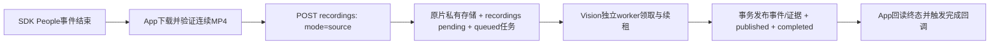

# 实际进展与待验收项

更新时间：2026-10-17（Asia/Shanghai）。本页按dev源码、本地验证和独立AWS部署记录汇总；任务数量是验证时点快照，不能当作实时监控。GitHub Issue 是否关闭仍须对应工作包的验收凭据。

## 本次发布范围与基线

本次在文档提交 `116cef7` 上继续同步AWS部署记录和只读查询SQL，不包含开发工作区尚未提交的 Android、People 管线、Vision worker 等实现。`dev` 运行代码核对基线仍为 `4cc9aa1`：已有 Backend、Agent 卡片/SSE、A/B 离线算法，以及新合入的 Linux 适配和事件 `shelf_level` 字段。Linux/GPU 实际运行不由本次文档核对证明。当前dev允许声明非空started_at进行UTC换算，但不验证它是真实拍摄时刻；本地SDK仍保留未知起点null。

| 范围 | dev 已有代码/契约 | 本地开发工作区已验证，源码待合入 |
| --- | --- | --- |
| 数据服务 | 14 个 Backend 操作；完整分析包导入、事件/证据、核查、向量 | 另7个 People 持久任务操作，公开 recordings source 模式 |
| Agent | 9个操作，显式启用后共23/28；卡片落库及运行终态SSE | Android 提问、计划确认、运行/停止/恢复、分页历史和引用界面 |
| API 草案 | 28=19 Backend（含5个未实现包裹操作）+9 Agent | 35=26 Backend（仍含5个未实现包裹操作）+9 Agent，挂载30 |
| 数据结构 | 11表79列，含 `runs.cards_json` 与 `events.shelf_level` | 原本地基线导出12表104列，含任务表和publication状态 |
| Android | 官方 KMP/Compose SDK 示例和配置模板 | 三入口界面、真实设备首页、People 管线、Agent 接入及新一轮设计还原 |
| Vision | A人物建档、B跟踪/货架交互、模型和离线输出 | API worker、租约、结果发布、A图库隔离与恢复 |

本地104列的验证基线早于 `4cc9aa1` 的 shelf 字段更新，**不能把104列当作最新 dev 与所有本地代码整合后的列数**。当前 dev 的 [SQL](database/schema.sql)、[OpenAPI](api/openapi.json) 与离线图继续描述 dev 已有契约；不能在本次文档更新后直接假定 source 模式或 worker 命令已经可用。

## AWS 独立部署与最新验收

用户已确认完成TCP80/443入站放行。公网 `https://35.84.190.14` 已签发IP证书、启用自动续期并实测App授权调用；Nginx上游为新增People容器的127.0.0.1:8001，原API8000保留。云端仍使用development最小Bearer鉴权，Agent关闭，实际21数据/任务操作，不能当作正式production认证或Agent云端已启用。

2026-10-17 03:11:13 +08:00直接查询Aurora `partrace/public`：**A completed 5段（4新自动、1历史），B queued 2段（新自动）**，原5条非People录像仍在。A的published、completed和App同ID完成回调已核对；B等待现场标定。A worker当前持续运行于Mac CPU，App依赖前台和SDK登录。

云端结构12表/104列包含shelf_level但尚无cards_json，不等于下述原本地104列结构；People源码和迁移尚待合入dev。实际ID、测试范围、异常原片重下、TLS/续期、只读SQL与回退边界见[AWS部署记录](deployment/AWS_PEOPLE_20261017.md)。上次本机13任务快照保留作历史记录，不能代替当前云端查询。

## 当前能力与证据

| 工作包 | 已有证据 | 未完成的验收 |
| --- | --- | --- |
| D01 协议 | SQL/OpenAPI、样例、模块映射及本地服务；本次修复旧79/78列快照偏差 | 团队冻结协议及后续本地扩展合入 |
| D02 Android | 本地三入口、消息中心与浮层；两台真实SDK设备首页；构建/安装 | 最新六图还原仍在修改，未见完整验收记录；Android真机 |
| D03 素材 | A/B算法、标定工具和文档已入dev；本地真实A录像已处理 | 固定场景完整素材、人工基准、时间校准和逐项对照 |
| D04 Vision | 本地及AWS真实A的CPU建档、Aurora发布与App回调已跑通；B算法代码已存在 | 当前球机B现场标定、区域映射、新配置版本和真实B完成回传 |
| D05 Backend | dev 数据/向量服务；AWS HTTPS/source-first、租约和Aurora原子发布实测；旧行逐值保留 | source-first实现合入；正式鉴权、生产部署与真实业务效果 |
| D06 SDK | 模拟器连接两台真实摄像头；People新自动事件经公网入Aurora，A回调、B排队 | Android真机；其余设备控制、回放定位能力分别验收 |
| D07 Agent | dev持久会话/运行、只读工具、卡片与SSE；本地真实模型生成计划成功 | 完整真实模型运行失败/超时；Embedding配置和真实事件引用闭环 |
| D08 Android业务 | 本地Agent提问/计划/运行/恢复/历史；新UI出现只读审核列表/详情 | 真实事件证据打开、任意时间/事件筛选、完整业务验收 |
| D09 人工核查 | Backend保存/回读接口已有；本地Android只读审核入口 | App人工保存表单、真实证据核查及App/服务重启回读 |
| D10 同一事件闭环 | 各子链已有部分验证 | 同一真实事件串起查询、开帧、Agent引用、人工保存、重启回读及演示录屏 |
| P1 包裹 | 2表5接口已设计 | 业务事务、扫码、人工确认与历史尚未实现 |

## People 管线：本地与独立 AWS 部署

用户确认 `recoding` 指 `recordings`；门铃为 A（人物建档），球形为 B（货架交互）。本地与独立AWS部署已验证、源码待合入dev的顺序是：

- `mode=source` 新建202、同内容重放200；旧完整包导入保留201/200。该扩展尚未进入dev源码和本次dev OpenAPI。pending 不计有效事实覆盖；事件、语义和Agent查询返回 `recording_not_ready`，不当作零事件。
- 原片字节保存在受限媒体目录，PostgreSQL保存元数据、任务状态与引用。SDK时间未独立校准，录像 `started_at=null`。
- 真实A：人工选择最近历史People录像，30.466秒、真实CPU运行44.902秒，5条匿名局部轨迹、10张内部选帧；业务事件/证据为0/0，因为建档不生成区域事件，不能据此说无人。已完成 App→API→真实算法→PG发布→App回调。
- 此前本机逐条核对快照：App13条真实任务全部已受理，1 completed、12 queued、0 failed；对应PG published/pending。B原片已入库，未宣称B解析完成。此前“5条B排队”属于更早快照。
- B仍缺当前画面的货架标定和 `zone_id` 映射。旧v1配置不可覆盖，新标定要新版本，已存旧任务不会自动改用新版本，仍需明确迁移方案。
- App completed 表示PG事实事务已提交；A图库CURRENT随后推广，不承诺此时B已读取新档案。崩溃恢复须按已完成同attempt核对图库，不能污染旧图库。
- App仅前台且SDK已登录时发现/处理；状态持久化，断网后已受理任务持续退避回读，最长间隔120秒；旧网络误标可恢复。后台常驻、系统推送和正式生产部署未完成；AWS公网HTTPS及development People部署已有上述实测。Agent run SSE与Vision任务回调分开。

## Agent 与 UI 验证边界

本地真实模型计划请求200（10.45秒、4步），执行请求202后分别出现 `agent_execution_failed` 和 `agent_timeout`，没有最终答复、引用或卡片。此次Agent演练使用 `rec_mock_001` 并明确显示模拟数据；不表示数据库只有模拟录像。Embedding的模型、维度与凭据尚未配置，未配置时明确503；没有保存失败运行的工具轨迹，不能据此断言唯一根因。

Agent当前基于授权事件元数据、描述和证据引用工作；生成计划的“扫描画面”文字不证明已具备视频理解。Android生产消息入口仍无真实告警来源。最新消息三态/审核样例仅用于明确标识的预览，不能作为真实消息或人工保存结果；审核读取不等于D09完成。最新六图UI尚无完整验证记录，历史五图不能替代。

## 已执行的本地验证

| 检查 | 记录中的结果 | 适用范围 |
| --- | --- | --- |
| Backend + Agent | 338通过、无skip，真实隔离PG/pgvector及ffprobe/ffmpeg | 本地source-first工作区，非最新dev重新测试 |
| Vision | 101通过 | 本地worker/图库实现及实际CPU依赖 |
| Android People | 15项通过，assemble/lint通过 | source上传契约、SDK排序、断网恢复；模拟器覆盖安装 |
| Android Agent | 8项通过，assemble/lint通过 | 4合同+4本地HTTP fixture，不等于8次外部模型或真实摄像头验收 |
| 实际设备 | 模拟器连接真实A/B，A闭环、B原片排队 | Android真机未测；无私有截图/录像随本文提交 |

本地People最终验收APK SHA256：`efdef983228aed493760c24af57e5c5a2a72c5d18ab37e996adcf5544f705e7b`。后续UI修改版本不能直接复用该凭据。本次文档更新只重新执行文档、JSON、链接、OpenSpec与离线图同步检查，不把历史业务测试列为当前dev全量回归。

## 后续交接

1. 保留当前本地源码，按模块评审并合入Android/People/worker扩展，与最新shelf字段共同核对SQL、迁移、API和样例。
2. 为B提供现场标定和区域映射，确认新配置与旧pending任务迁移后跑同一真实B事件。
3. 补齐Embedding配置并排除Agent执行失败，完成真实录像结果/证据引用验收。
4. 完成App人工核查保存、重启回读、最新UI/真机及D10固定脚本与录屏。

本文不关闭Issue，不证明生产部署完成。私有配置、令牌、录像、人物帧和本地截图均不随本次文档提交。

## 上次文档同步检查（116cef7）

本次从dev基线在独立临时空库加载原DDL并读取pg_catalog，校验后清理临时库：11表79列、13外键、30索引、54 CHECK、25触发器。只修正SQL注释、文档生成器计数及旧快照，没有改变DDL行为或迁移业务库。

已通过五项设计同步检查、78组件schema/52 JSON fixture校验、OpenSpec四项严格检查、修改文档的本地链接与空白检查。补齐五个Agent run样例的cards字段、SSE阶段计数和离线工作台。未重跑或宣称最新dev的业务全量回归；上文历史本地测试范围保持原有口径。

## 本次 AWS 文档同步

本次仅复核云端容器、IP证书/续期、Aurora带时间状态快照，并核对已有App完成回调凭据；新增部署记录与只读SQL，更新各模块入口。15项PG任务测试、13项Android测试及构建/lint属于实际部署阶段的凭据，本次纯文档提交不重跑或宣称dev业务全量回归。检验本文相对链接、SQL只读执行、五项设计同步和diff；不修改SQL DDL/OpenAPI设计契约，不提交私有凭据或媒体。
