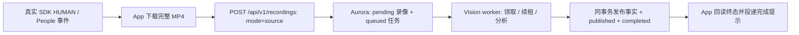

# AWS 公网 HTTPS 与真实 People 录像验收

更新：2026-10-17（Asia/Shanghai）。本文保留独立部署历史；本次开发整合已包含 Android、People API、worker 和部署脚本，尚未以整合版重部署 EC2。源码基线与完整检查见[版本说明](../releases/DEVELOPMENT_20261017.md)。关联工作包：[D04 #4](https://github.com/SUertee/partrace-vision/issues/4)、[D05 #5](https://github.com/SUertee/partrace-vision/issues/5)、[D06 #6](https://github.com/SUertee/partrace-vision/issues/6)；本文不关闭这些 Issue，也不代替 D10 完整业务验收。

门铃 A 已用真实历史原片及新自动 People 事件验证 **App 下载 → 公网 API → Aurora pending → Vision → published/completed → App 完成回调**。球机 B 的真实自动原片已入 Aurora，现场标定和区域映射尚未完成，因此保留 pending/queued。

## 部署与源码基线

先前 `df2de62` 只更新部署文档和只读查询 SQL，其运行代码基线为 `4cc9aa1`。本次 person_id 提交在该基线上补充事件字段、独立迁移和既有 Vision 出口；Android、People API、任务迁移、worker 和部署脚本仍未随本次合入，不能从 dev 直接重建完整的独立 People 部署。本次整合后的 [SQL](../database/schema.sql) 为 12 表/106 列，包含 People、shelf_level、person_id 与 cards_json；云端仍是独立补丁版本，不能将源码合入当作云端已同步。

| 项目 | 本次核验的实际状态 |
| --- | --- |
| 公网入口 | `https://35.84.190.14`，App 基址不加 `/api/v1` |
| TLS | Let’s Encrypt IP SAN 证书，IP 匹配；本次证书到期时间 `2026-10-23T09:26:33Z` |
| 网络 | 用户已确认新增 TCP 80/443 入站；外部 HTTP-01 文件与 HTTPS 实际可达。未因实例角色无 EC2 修改权限而绕过安全组 |
| 反向代理 | Nginx 对外监听 80/443，HTTPS 代理至 `127.0.0.1:8001`；80 保留 HTTP-01，其余重定向 HTTPS |
| People API | `partrace-people-api-20261017`，当前镜像 `partrace-vision-api:person-id-20261017`，21 个数据/任务操作，Agent 关闭 |
| 原 API | `partrace-vision-api-1`，`127.0.0.1:8000`，保留供受控回退；未删除或覆盖其 Git 工作树 |
| 数据库 | 原 Aurora 集群内 `partrace` 库、`public` schema，沿用 EC2 实例角色 IAM 认证 |
| 鉴权 | `development` 最小 Bearer 注册表；App 与 A worker 使用独立凭据和精确镜头授权。正式 production 鉴权尚未完成 |
| Vision | 独立 A worker 在开发 Mac 上以 CPU 持续运行，通过 API 领取、下载、续租、发布；不直写业务 PG |
| Android | 已登录的 API 37 arm64 模拟器连接两台真实摄像头；自动发现和处理要求 App 前台、SDK 已登录，未验收 Android 真机或系统后台常驻 |

People 镜像以服务器 `dev_hua@39aa4ab` 为基线合入本地任务实现，保留 `shelf_level`、可空 `zone_id` 和该基线的 UTC 声明规则。发布目录 `/opt/partrace-people-20261017`；运行数据继续位于 `/srv/partrace-vision/.local-state`。源码冻结包和本地验收凭据保留在被忽略的私有目录，未将密钥、令牌、录像、人物帧或私有配置提交到 Git。

初次 People 部署为 12 表/104 列；004 迁移后云端为 12 表/105 列，含 person_id，尚无 runs.cards_json。本次整合源码为 12 表/106 列，同时包含 shelf_level、person_id、cards_json；不能将两份结构混用。

## 原片先入库，再发布分析结果



部署扩展使用 multipart `mode=source`、原片任务 `manifest`、恰好一个 `files` 文件 `source.mp4`。新原片返回 **202**；相同内容重放 **200**。原有完整分析包导入保留默认结果模式 **201/200**，两者不能混为同一个清单。

Backend 先验证权限和真实媒体，原子保存 pending `recordings` 与 queued `recording_jobs`。worker 通过独立租约领取任务；完成时发布结果、更新 published 和 completed 在同一 PG 事务内提交。App 回读持久 completed 后发出完成回调；轮询暂时失败会退避重试，不把网络错误当作 Vision 分析失败。该回调不是 Agent run SSE，也不是安卓系统远程推送。

视频字节保存在 **EC2 受限媒体目录**，Aurora 保存录像元数据、任务状态、存储键和最终事实。SDK People 只作为触发来源，不能冒充团队区域动作；待解析录像的事件/语义/Agent 事实查询返回 `recording_not_ready`，不能解释为无人或零事件覆盖。

A 是人物建档阶段，不发布区域动作，所以这批 A 录像的业务事件/证据数为 **0/0**；内部人物选帧与图库不是已发布业务证据，也不证明自然人身份。A 图库 CURRENT 在 Backend 完成确认后再推广，与 PG 不构成跨文件系统原子事务。SDK 时间尚未独立校准，录像 `started_at=null`；以下受理/完成时间是服务端时间，不能当作拍摄 UTC 起点。

## 真实硬件凭据

2026-10-17 **03:11:13 +08:00**（`2026-10-16T19:11:13Z`）直接查询 Aurora 的快照：

| 镜头 | 来源 | 数量 | Aurora 状态 | App 验证 |
| --- | --- | ---: | --- | --- |
| 门铃 A / `cam_doorbell_a` | 1 条历史手动 + 4 条新自动事件 | 5 | `published / completed` | 完成状态回读及完成提示标记已确认 |
| 球机 B / `cam_sphere_b` | 新自动 People 事件 | 2 | `pending / queued`，原片 available | 已受理、等待解析，未报完成 |

这是时间点快照，持续采集后数量会变化。原 5 条非 People 录像仍保留。迁移前原库还有 3 条事件、1 条证据和 2 个用户；先保存全表快照，执行两项增量迁移，再逐值校验原 11 表全部旧行一致。随后新增独立受限身份，没有执行 `init-db`、重建库或覆盖旧数据。

可按以下稳定 ID 定位：

| 验收项 | recording_id / job_id | 时长 | 服务端完成时间 |
| --- | --- | ---: | --- |
| A 历史手动 | `20ac5b8bf48bee8817fb68195b823f81a3700314530bbe69b184067348749844` | 22.266 秒 | `2026-10-16T18:53:29.095882Z` |
| A 新自动 | `e815c058d25d9118ddfd7e1c3643b64ec090ad099157ba4dc721ea41f8b9a05a` | 30.066 秒 | `2026-10-16T18:57:40.998799Z` |
| A 异常下载恢复后 | `9841a9d3a765d58846a449566da6d10c7373c719ca0bf8fe83343c38e93de33e` | 30.599 秒 | `2026-10-16T19:06:58.851417Z` |
| B 新自动 | `76a98318bb7f8bd9da325abd78f18e338818659356cf83bfbc71cf6fc61dedd4` | 10.507 秒 | 尚未完成 |
| B 新自动 | `3393f0f1cf3e57b4d4b6954f1bac8993ceead8572cebfb41aec02ca556cf3d2b` | 12.055 秒 | 尚未完成 |

A 历史原片的真实 CPU 算法耗时 36.741 秒，4 条匿名局部轨迹、1 个达到质量门槛的新档案和 5 张内部原始选帧；未调用外部模型，人物身份未人工验证。其 App 来源保留 `manual_history`，新自动任务保留 `automatic`，没有虚构事件或手工改成 completed。

异常恢复项的第一次 SDK 下载得到 29.199 秒 MP4，存在 H.264 SPS/帧解码错误，Backend 返回 422 并拒绝创建录像/任务。通过 App 明确的“重新下载原片”动作，重新取得同事件的完整 30.599 秒录像，保持原任务 ID 后成功受理、解析及回调。该恢复仅允许尚未受理的验证错误原片；已受理、已完成和幂等冲突任务不能替换原片。本轮没有转码坏片或放宽后端严格解码。

期间少量读取/上传出现暂时 503，持续退避恢复；随后公网用户/任务读取均 200，容器无重启、未 OOM。该观察不等于长期可用性或生产负载验收。

## 在 Aurora 查询

在已迁移的 AWS `partrace` 库执行 [aurora-people-status.sql](../database/aurora-people-status.sql)。该只读 SQL 针对上述部署扩展；未应用 People 迁移的既有库不能直接执行。

```sql
SELECT r.recording_id, r.camera_id,
       r.publication_status, j.status AS vision_status,
       r.duration_ms, j.finished_at
FROM public.recordings AS r
JOIN public.recording_jobs AS j ON j.job_id = r.recording_id
WHERE r.camera_id IN ('cam_doorbell_a', 'cam_sphere_b')
ORDER BY j.created_at DESC;
```

不要把 Aurora 主机或 5432 填成 Android API 地址。App 使用 `https://35.84.190.14` 与独立 Backend Bearer；不使用 SSH 私钥、SDK Token、模型密钥或数据库凭据。

## HTTPS 与运维交接

- 用户已确认新增 80/443 入站；80 的 HTTP-01 验证文件已返回 200，公网证书按 IP 正常验证，无跳过证书校验。
- `/health/live` 外部 200；未授权 `/api/v1/user` 返回 401；`/docs` 与 `/openapi.json` 外部 404。People API 的本机 readiness 为 200。
- 使用 Certbot `v5.4.0`；续期服务 `partrace-public-ip-renew.service` 与 timer 已启用，每日检查两次并重载 Nginx。本轮手动执行服务为 `Result=success / ExecMainStatus=0`。短期证书不能依赖人工续期，IP 改变后须重新签发对应 IP 证书。
- 服务端已有运维文件在 `/opt/partrace-public-ip` 和 `/opt/partrace-people-20261017/operations`。它们属于独立部署交付，本次源码已收录对应 infra 目录；服务器文件仍按原发布版本运行。显式重配时第三参数 `8001` 不可遗漏，否则可能指回旧 API。

```sh
sudo systemctl status partrace-public-ip-renew.timer
sudo journalctl -u partrace-public-ip-renew.service
sudo nginx -t
# 仅在需要显式重配既有入口时执行；日常续期由 timer 完成：
sudo bash /opt/partrace-public-ip/configure.sh issue 35.84.190.14 8001
```

原 API/旧镜像仍保留；回退前须限制新原片入口并评估旧查询对 pending 的语义，不能直接把旧 API 暴露给新客户端。保留新增表/列及所有数据，不执行破坏性降级。不要直接用当前 dev 重建覆盖该独立 People 镜像。本次源码已整合 shelf 字段、cards、People 和 person_id；后续部署仍须核对实际旧库差异和显式迁移。

## 验证范围与剩余工作

本次业务验收实际执行：兼容部署代码的 **15 项 People PostgreSQL 集成测试**（无 skip，真实 ffprobe/ffmpeg）；Android JDK 17 `assembleDebug`、`lintDebug` 和 **13 项 People 目标测试**；真实摄像头、API、Aurora 和 App 同 ID 回调核对。APK SHA-256 为 `3bb05a79fce7d33677bafac9242455e7e3c1baf732ed7438f3395dd789f98b2c`。这是独立工作区/部署的验收，不是本次文档提交后 dev 的业务全量回归。

仍待完成：

1. **B 现场标定/区域映射。** 发布新配置版本，并明确旧 v1 pending 原片如何迁移；不能覆盖不可变旧配置或直接宣称 B 完成。
2. **worker 的服务器运行交付。** A 当前在 Mac CPU 进程持续运行；Mac/进程停止后，API 可继续保存 pending 原片，但不会自行解析。
3. **Android 真机、系统后台常驻与正式生产鉴权。** 当前验证依赖前台 App 和 SDK 登录，公网 HTTPS 不代表上述事项完成。
4. **源码整合与完整业务闭环。** 本次已纳入 People 源码、迁移与部署脚本；Agent 云端启用、真实区域事件/证据引用、人工核查和 D10 独立验收，本文不提前标为完成。

## person_id 字段补丁 · 2026-10-17

Aurora 已执行 `004-event-person-id.sql`，增加可空的 A 图库 G 编号；3 条旧事件全部旧字段逐值不变，新列均为 `NULL`。云端当前镜像为 `partrace-vision-api:person-id-20261017`，基于原 People 镜像构建，保留 `shelf_level`、任务流程、loopback 8001 和现有 Nginx/TLS。

独立发布目录 `/opt/partrace-person-id-20261017` 保存补丁与 root 私有的迁移前 events 快照；旧 People 容器保留为 `partrace-people-api-20261017-before-person-id`。新容器 readiness 200，21 个操作的契约含 person_id；公网正常验证证书后 health 200、无凭据 recordings 401、App 既有凭据读取 recordings 200。既有 8000 API 保留，不执行破坏性数据库降级。

本次 dev 合入与该云端补丁共享字段语义，但People 源码已随本次开发版整合，云端仍未重部署该整合版。B 尚缺现场标定，没有真实 B 匹配 G 编号的入库事件；详见[D04 验证](../../openspec/changes/d04-event-person-id/verification.md)。
