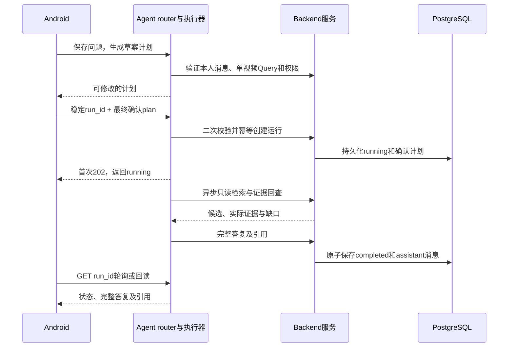

# Backend 与 Agent 联动设计

**首版：同一个 Python + FastAPI 应用，两个职责模块，通过 Python 接口注入联动。** Android 只配置一个 API 地址；Backend 管数据与事务，Agent 管计划、模型与执行。内部调用不绕回本机 HTTP，不新增公开路由或数据库表。

关联 [M04 事件证据](README.md#m04)、[M05 语义检索](README.md#m05)、[M06 AI 会话](README.md#m06)，工作包为 [D05](../DEVELOPMENT_PLAN.md#d05--共用事件与证据服务) 和 [D07](../DEVELOPMENT_PLAN.md#d07--agent-计划只读检索与引用)。字段以 [OpenAPI](../api/openapi.json) 和 [SQL](../database/schema.sql) 为准；内部行为提案见 [OpenSpec](../../openspec/changes/d05-d07-backend-agent-link/proposal.md)，仍待两位主责确认。

## 谁负责什么

| 交付 | Backend · Harry Xu | Agent · 韩广宁 |
| --- | --- | --- |
| 身份与权限 | 认证主体、active／owner／scope、录像和引用归属校验 | 每个请求、工具和答复提交使用 Backend 的权限服务 |
| 事实与检索 | 录像／事件／帧读取，查询编码、pgvector 同空间检索 | 调用只读工具，解释候选，回查引用；不直连 DB |
| AI 历史 | 连接与事务，`conversations / messages / runs` 存储与约束 | 发起会话、消息、运行流程；通过受限服务保存 |
| AI 执行 | 校验与规范化 Query，提供运行状态的原子更新 | 问题转计划、模型调用、任务注册、取消与超时 |
| 应用组合 | 在工厂显式挂载 Agent router，统一 `/api/v1/agent` 前缀 | router 使用 `/plans`、`/runs` 等相对路径，不重复加前缀 |

Agent 可写自己的 AI 历史；事实工具只能读。事件导入、向量写入、人工核查保存、包裹入出库不交给模型工具，管理员确认仍由 Android → Backend 完成。

## 最小内部交接接口

以下为待实现的接口粒度与方法名，不是现成包。返回结构复用当前 OpenAPI DTO；错误经统一映射返回现有 ErrorResponse，不在各模块重复定义。

| Backend 提供的接口 | Agent 怎么调用 | 必须保证 |
| --- | --- | --- |
| `AccessPolicy`／服务端 `AuthContext` | 取得本人身份，验证计划和本次运行范围 | 身份从有效认证解析，不相信请求／模型自报的 user_id；权限变更后重新校验 |
| `FactReader`：`query_events`、`get_event`、`get_evidence`、录像／配置读取 | 带上下文和固定 Query 查询，回查引用 | 只读；Event 须属于录像／区域并命中窗口，Evidence 属于该 Event，可保留前后真实上下文帧，定位仍在同一录像 |
| `FactReader.semantic_search_events` | 提交实际 query_text、固定 Query、top_k／min_score | Backend 决定模型／版本／维度并编码；不接客户端向量或任意 SQL；返回索引缺口 |
| `AIHistoryService`：会话／消息、`start_or_replay_run`、`read_run` | 创建本人历史，提交确认计划，按 run_id 回读 | 身份／时间／model_key 来自服务端；稳定 ID 幂等，不重复启动 |
| `AIHistoryService`：`complete_run`、`stop_run`、`fail_run` | 提交已核查引用与完整答复，或取消／失败 | 锁定或条件更新 running；完成与唯一 assistant 消息同事务；终态不可覆盖 |

Backend 定义小型协议和数据对象，具体仓储／连接仅在 Backend 内部。Agent 依赖协议，不导入数据库实现；`fail_run` 和重启恢复是服务内部操作，不暴露给模型或新增公共 API。

## 从问题到答复

G、B 是同一 FastAPI 应用内的模块。模型由 Agent 调用，模型选择及凭据配置仍待确认；鉴权上下文、数据库连接与凭据不进入 prompt。

| App 提交 | 服务端派生／验证 |
| --- | --- |
| `conversation_id` | 本人 user_id、创建时间；会话不绑定录像 |
| `message_id + content` | 固定 role=user、run_id=null 和时间，拒绝伪造助手答复 |
| `input_message_id + scope` | 本人 user 消息与单视频五字段 Query；Agent 计划入口使用规范化偏移，不接混合时间窗口 |
| `run_id + input_message_id + plan` | 会话从消息派生；完整 plan 含 query、query_text、steps，model_key、状态与时间由服务端设置 |
| 读取／停止时的 `run_id` | 以该运行保存的 plan.query 动态验权，不用会话或其他轮次录像代替 |

`POST /api/v1/agent/runs` 首次返回 **202**，同 ID 同规范内容重放 **200**，不同内容 **409**；run_id 由 App 稳定提交，不在每次请求重新生成。先保存 running 再启动受控后台任务，任务启动失败要明确转 failed，不能留下无执行的 running。

draft plan 不落表，App 确认后的计划是执行依据。二次校验检查当前权限、配置、录像、区域、窗口与允许工具，不声称能与不存在的初始 draft 记录比较；运行创建后固定使用保存的 plan.query。steps 是展示描述，不允许模型通过文本指示任意执行工具。

## 持久化、停止与重启

- **完成：** 提交前重新验权，按 FactReader 的事件／上下文帧归属规则验证引用和媒体状态；只有 running 可转 completed，与唯一完整 assistant 消息同事务提交，任一步失败整体回滚。summary 从消息正文读取。
- **停止：** 原子 running → stopped 后通知执行器取消；迟到结果不能追加答复／引用或改为 completed。若完成已获胜，停止回读当前终态。stopped／failed 的 summary 为空，不保存伪完成消息。
- **重试：** 同 run ID 仍先验权及比较规范请求，再读旧结果；用户重新执行失败任务使用新 run ID，保留原历史。
- **重启：** 首版单执行实例启动将遗留 running 标为 failed／service_restarted，不自动续跑。内存任务注册表只管理当前实例，不替代持久化状态；多 worker／多实例不能直接扫全库 running，执行归属／租约另行设计。
- **权限：** 会话和 user 问题只按 active owner；运行、停止、完成及助手历史按本次录像授权。消息页包含无权助手答复时整页 403，不返回部分正文或静默跳过。

## 下一步按四个交付推进

| 顺序 | 主责 | 交付与检查 |
| --- | --- | --- |
| 1 · 固定交接 | Harry Xu＋韩广宁 | 确认上述协议、DTO、错误、运行超时与单执行实例；以当前 Query／AgentPlan／AgentRunRequest 为准 |
| 2 · Backend 服务 | Harry Xu | 先交只读事实及权限服务，再交本人历史、幂等运行和原子终态事务；测试重试、越界、撤权、并发停止与持久化 |
| 3 · Agent 接入 | 韩广宁 | 将 agent 做成可导入 Python 模块；实现八个 router 操作、计划／模型适配器、受控任务和取消，显式注入 Backend 服务 |
| 4 · 联调 | 两位主责，李果钦接 App | 先用明确样例适配器核对交接，随后用同一真实事件与帧验证问题→计划→检索→引用→答复→回读，并测试停止及重启失败 |

第 2、3 步可在接口确认后并行；先交一个问题和一个事件的最小闭环，再扩大输入。依赖锁、统一运行环境与实际启动命令由实现时的模块 README 记录，不提供尚不存在的 Agent 安装命令。

当前 Agent 目录只有说明；本地待提交 Backend 骨架的 `create_app(agent_router=...)`／`register_agent_router` 只提供挂载点，默认应用未接真实 Agent。健康探测与演示 router 测试不是模型、鉴权或业务接通凭据，本次只定义联动，不提交这些并行代码。

当前仅有按已知 run_id 读取运行的 API，停止／失败不会生成助手消息；App 重启后不能只靠消息列表发现全部运行。运行列表、SSE、工具步骤历史及多实例恢复另行评审，不计入现有 27 个 API。P1 包裹只读工具在 D10 主闭环后补充。
