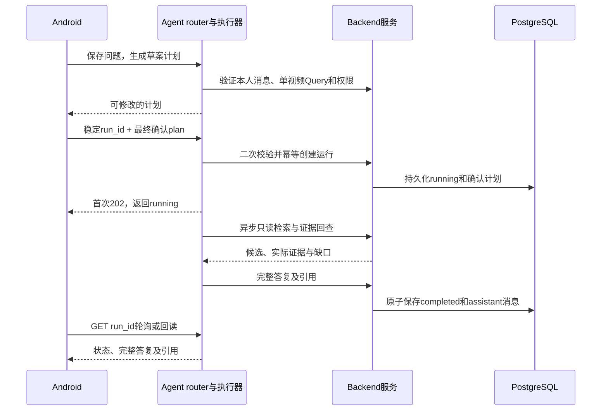

# Backend 与 Agent 联动设计

**本地实现：同一个 Python + FastAPI 应用，两个职责模块，通过 Python 接口注入联动。** Android 只配置一个 API 地址；Backend 管权限、数据、事务和运行生命周期，独立 Agent 包管计划、模型与受限工具循环。内部不绕回本机 HTTP，沿用既有公开路由和数据库表。

关联 [M04 事件证据](README.md#m04)、[M05 语义检索](README.md#m05)、[M06 AI 会话](README.md#m06)，工作包为 [D05](../DEVELOPMENT_PLAN.md#d05--共用事件与证据服务) 和 [D07](../DEVELOPMENT_PLAN.md#d07--agent-计划只读检索与引用)。字段以 [OpenAPI](../api/openapi.json) 和 [SQL](../database/schema.sql) 为准；原内部行为提案见 [OpenSpec](../../openspec/changes/d05-d07-backend-agent-link/proposal.md)，当前实现及验证见 [D07 change](../../openspec/changes/d07-create-agent/verification.md)。安装、私有配置和启动见 [Backend README](../../backend/README.md)，工具与包入口见 [Agent README](../../agent/README.md)。

当前已合入 `dev@4cc9aa1` 的应用默认挂载 14 个 Backend 数据操作；显式 `PARTRACE_AGENT_ENABLED=true` 后挂载 9 个 Agent 操作，共实现 23／28。P1 包裹 5 个契约操作尚未实现。People 原片任务与 source-first 是本地已验证、尚未合入的扩展，增加七个 Backend 操作后为 30／35；本次只同步文档。两种源码范围、Android 联调和未验收项统一见 [项目实际状态](../PROJECT_STATUS.md)。

## 谁负责什么

| 交付 | Backend · Harry Xu | Agent · 韩广宁 |
| --- | --- | --- |
| 身份与权限 | 认证主体、active／owner／scope、录像和引用归属校验 | 每个请求、工具和答复提交使用 Backend 的权限服务 |
| 事实与检索 | 录像／事件／帧读取，查询编码、pgvector 同空间检索 | 调用只读工具，解释候选，回查引用；不直连 DB |
| AI 历史 | 连接与事务，`conversations / messages / runs` 存储与约束 | 发起会话、消息、运行流程；通过受限服务保存 |
| AI 执行 | 规范化 Query，原子运行状态、任务注册、取消和独占执行器 | `create_agent` 生成计划和答案，限制模型／工具调用与超时 |
| 应用组合 | 工厂显式挂载 `backend.api.agent`，统一 `/api/v1/agent` 前缀 | 提供可导入的 `partrace-agent` 引擎与 `ToolGateway` 协议 |

Agent 可写自己的 AI 历史；事实工具只能读。事件导入、向量写入、人工核查保存、包裹入出库不交给模型工具，管理员确认仍由 Android → Backend 完成。

## 最小内部交接接口

以下为当前实现入口，返回结构复用 OpenAPI DTO，统一返回现有 ErrorResponse。它们组合在同一应用中，不作为额外公开 API。

| Backend 提供的接口 | Agent 怎么调用 | 必须保证 |
| --- | --- | --- |
| `BackendService.authenticate/transaction/normalize` | 验证本人、状态、scope、录像与规范化 Query | 身份来自有效认证，不相信模型自报 user_id；请求、工具和完成提交重新验权 |
| `ScopedToolGateway`／`ToolGateway` | `search_events/get_event/get_evidence/read_recording` | 只读且固定 Query；Event 须命中录像／区域／窗口，Evidence 属于该 Event，可保留同录像中的前后上下文帧 |
| `SemanticService`，经 `semantic_search_events` 工具调用 | 固定 query_text、Query、top_k／min_score | Backend 决定编码空间；不接客户端查询向量，不接任意 SQL；返回索引缺口 |
| `AIHistory` | 本人会话／消息、幂等 `start_run/get_run`、`complete_run/stop_run/fail_run` | 身份／时间／model_key 来自服务端，完成与唯一 assistant 消息同事务，终态不可覆盖 |
| `AgentRuntime`＋独立 `AgentEngine` | 创建受控后台任务、执行图、停止与故障恢复 | 先持久化 running 再执行，单执行器 lease，资源限额与重启失败恢复 |

Agent 包只依赖协议，不导入数据库实现；具体仓储、SQL、连接与凭据留在 Backend。五个工具是 `search_events`、`semantic_search_events`、`get_event`、`get_evidence` 和 `read_recording`；`fail_run`／恢复不是模型工具。查询只返回元数据和已有描述，没有向 VLM 传图，引用有效不等于模型看图或动作验真。

当前代码位置：公开路由在 `backend/api/`，运行、权限 Gateway、历史与模型适配在 `backend/ai/`，事实和向量服务在 `backend/services/`；Agent 引擎与 `prompts.py` 在 `agent/`，工具注册和证据读取校验在 `agent/tools/`。实际目录和启动说明见两模块 README。

## 从问题到答复

G、B 是同一 FastAPI 应用内的模块。模型和文本编码器使用服务端 OpenAI 兼容适配器，配置见 [环境模板](../../backend/.env.example)；密钥只放私有环境，不进入聊天、源码、日志或 prompt。缺模型返回 503，不用 fake 模型或模拟向量回退。

| App 提交 | 服务端派生／验证 |
| --- | --- |
| `conversation_id` | 本人 user_id、创建时间；会话不绑定录像 |
| `message_id + content` | 固定 role=user、run_id=null 和时间，拒绝伪造助手答复 |
| `input_message_id + scope` | 本人 user 消息与单视频五字段 Query；Agent 计划入口使用规范化偏移，不接混合时间窗口 |
| `run_id + input_message_id + plan` | 会话从消息派生；完整 plan 含 query、query_text、steps，model_key、状态与时间由服务端设置 |
| 读取／停止时的 `run_id` | 以该运行保存的 plan.query 动态验权，不用会话或其他轮次录像代替 |

`POST /api/v1/agent/runs` 首次返回 **202**，同 ID 同规范内容重放 **200**，不同内容 **409**；run_id 由 App 稳定提交，不在每次请求重新生成。先保存 running 再启动受控后台任务，任务启动失败要明确转 failed，不能留下无执行的 running。

draft plan 不落表，App 确认后的计划是执行依据。二次校验检查当前权限、配置、录像、区域、窗口与允许工具，不声称能与不存在的初始 draft 记录比较；运行创建后固定使用保存的 plan.query。steps 是展示描述，不允许模型通过文本指示任意执行工具。

## 持久化、停止与重启

- **完成：** 提交前重新验权，按 FactReader 的事件／上下文帧归属规则验证引用和媒体状态；只有 running 可转 completed，与唯一完整 assistant 消息同事务提交，任一步失败整体回滚。summary 从消息正文读取。
- **停止：** 原子 running → stopped 后通知执行器取消；迟到结果不能追加答复／引用或改为 completed。若完成已获胜，停止回读当前终态。stopped／failed 的 summary 为空，不保存伪完成消息。
- **重试：** 同 run ID 仍先验权及比较规范请求，再读旧结果；用户重新执行失败任务使用新 run ID，保留原历史。
- **重启与执行归属：** 使用 `--workers 1`，专用 PostgreSQL 连接持有 session advisory lease，拒绝同数据库／schema 的第二执行器；取得 lease 后将遗留 running 标为 failed／service_restarted，不自动续跑。内存任务表不替代持久化状态，不支持多实例调度。
- **短暂 DB 故障：** 失败终结暂时不能写库时，保留内存待终结项并每 5 秒重试；若进程也退出，下次独占执行器启动恢复遗留状态，不恢复模型过程。
- **资源和游标：** 默认每次模型最多 8 次调用、工具 12 次、总超时 60 秒，并发运行 2 个。首次启用生成 `.local-state/agent-cursor.key`（32 字节、0600），必须持久保留，重建会使旧历史分页游标失效。
- **权限：** 会话和 user 问题只按 active owner；运行、停止、完成及助手历史按本次录像授权。消息页包含无权助手答复时整页 403，不返回部分正文或静默跳过。

## 已有实现与下一步验收

| 顺序 | 主责 | 交付与检查 |
| --- | --- | --- |
| 1 · 本地事实与历史 | Harry Xu | 已有受限服务与真实 PG 测试；保留 [D05 验证](../../openspec/changes/d05-backend-mvp/verification.md)，当前向量及 AI 验证见 D07 |
| 2 · Agent 图和路由 | 韩广宁＋Harry Xu | 独立包、九个操作（含卡片与 SSE）、实际图的 fake 模型、取消／重启及权限边界已用于本地测试 |
| 3 · 外部模型 | 两位主责 | 本地真实模型计划已返回，完整运行出现失败／超时；Embedding 尚未配置，供应商兼容、模型空间与完整引用链仍待验收，见 [项目实际状态](../PROJECT_STATUS.md) |
| 4 · 真实业务与 App | 四人，李果钦接 App | 用同一真实视觉事件与帧验证问题→计划→检索→引用→答复→人工保存→回读；Android／D10 尚未验收 |

统一在 `backend/` 执行 `uv sync --locked` 安装本地 Agent 依赖，`uv run pytest` 覆盖两模块；具体启动见实现 README。真实 PostgreSQL + pgvector 与实际 `create_agent` 图均已用于测试，图使用显式 fake 模型；这些测试不替代真实视频业务、部署或完整 D10。当前本地实测和代码合入范围见 [项目实际状态](../PROJECT_STATUS.md)，历史实际命令与结果保留在 [D07 验证](../../openspec/changes/d07-create-agent/verification.md)。

当前 `dev` 可按已知 run_id 读取运行，或经 `GET /api/v1/agent/runs/{run_id}/events` 订阅 SSE 终态推送（快照先行、提交后推送、completed 落库卡片包、stopped/failed 合成状态卡），停止／失败不会生成助手消息。此 SSE 属于 Agent 运行，不承担 Vision 解析完成回调；本地 Android Agent 接入使用轮询。App 重启后不能只靠消息列表发现全部运行。运行列表、工具步骤历史及多实例恢复另行评审，不计入当前 `dev` 的 28 个 API。P1 包裹只读工具在 D10 主闭环后补充。
