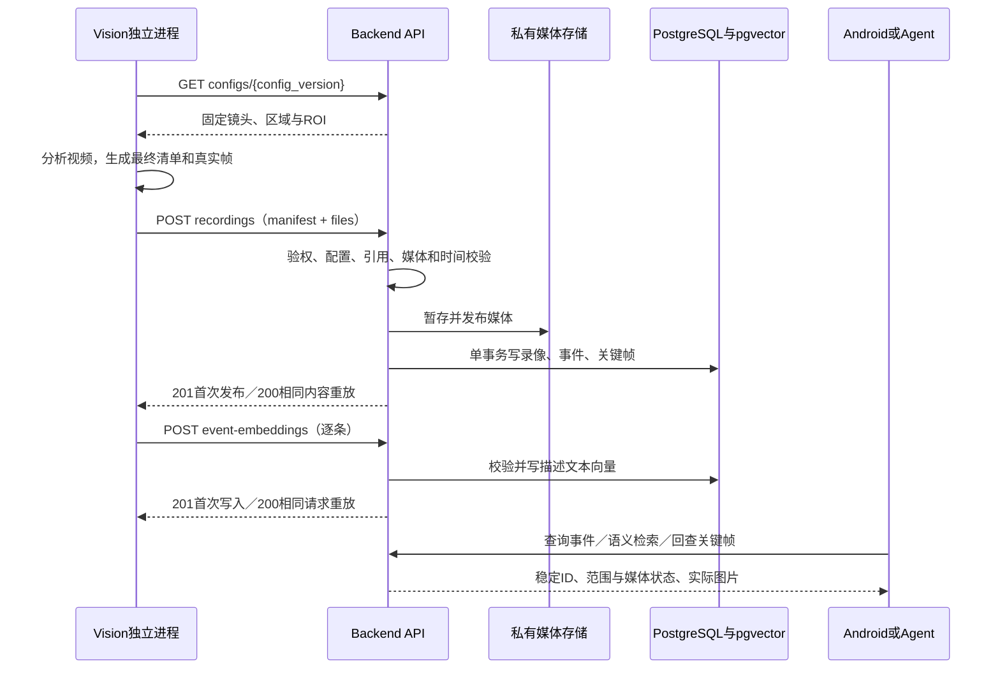

# Backend 与 Vision 联动设计

**视觉算法使用独立 Python 工作进程，先完成视频分析，再通过 Backend 的既有 API 发布完整结果包。** Backend 使用 FastAPI，负责权限、校验、媒体保存和数据库事务；Vision 不直连业务数据库，首版可用批处理程序与导入客户端，无需额外部署 HTTP 服务。

关联 [M03 视觉产物与视频入库](README.md#m03)、[M04 事件与证据](README.md#m04)、[M05 语义检索](README.md#m05)，对应 [D03 素材与人工基准](../DEVELOPMENT_PLAN.md#d03--固定素材与人工基准)、[D04 事件与证据包](../DEVELOPMENT_PLAN.md#d04--算法事件与真实证据包) 和 [D05 共用服务](../DEVELOPMENT_PLAN.md#d05--共用事件与证据服务)。字段、必填项和返回结构以 [OpenAPI](../api/openapi.json) 为准，表与约束以 [SQL](../database/schema.sql) 为准。本页整理既有交接约定，不新增表、API 或任务调度协议。

截至本次本地核对，Backend 开发工作区已有完整包导入、事件／关键帧读取及两个向量操作，对应实现与验证记录随各自开发提交另行交付；[Vision 目录](../../vision/README.md) 当前只有开发入口，尚无算法程序。本次发布交接文档，不代表真实视觉效果、外部编码器或 Android D10 已验收。

## 谁负责什么

| 交付 | Vision · 徐泽华 | Backend · Harry Xu |
| --- | --- | --- |
| 固定素材与基准 | 连续预录视频、ROI 对照、人工事件时间表；标明多人、遮挡和未知区间 | 提供版本化镜头／区域配置；需要 UTC 时准备独立可核验的时间基准 |
| 检测与匿名跟踪 | 检测、同视频匿名片段、区域事件；输出视频偏移、来源和观测／候选状态 | 检查配置归属、时间范围、ID 与跨对象引用，保存原始事件 |
| 关键帧 | 从同一源视频导出真实 PNG／JPEG；提供偏移、可选实际观测框 | 验证媒体文件，分配私有存储键，提供元数据与图片字节读取 |
| 完整结果包 | 本地完成分析后，交接 `RecordingManifest`、视频和帧文件；重试复用 ID 与原内容 | 校验后事务写入 `recordings / events / evidence`；发布失败回滚并按结果清理媒体 |
| 可检索描述与向量 | 输出可核对描述，按共同确认的模型／预处理版本生成文本向量 | 校验 Event／Evidence 归属、向量与模型空间，写入 `event_embeddings`；用同空间编码查询 |
| 联调与效果 | 逐样本记录误检、漏检、时间偏差与 Track 切换，说明自动／人工来源 | 核对导入、重试、回读、媒体缺失与检索缺口；向 Android／Agent 提供稳定事实接口 |

模型、维度和描述生成方式由算法与后端共同确认；当前没有“只交文本、Backend 自动批量编码”的独立 API。Agent 通过 Backend 的只读工具检索与回查，人工核查决定由管理员在 Android 显式保存，不写回算法事件。

## 视觉模块涉及哪些表

以下读写均由 Backend 执行；Vision 交付 API 输入。媒体文件保存在受限文件存储，数据库保存引用。

| 表／配置 | Vision 交接内容 | Backend 读写与关系 | 服务端派生或控制 |
| --- | --- | --- | --- |
| 版本化配置文件 | 使用已发布的 `config_version / camera_id / zone_id`，按其 ROI 处理 | 读取配置并校验镜头、区域归属；不新增 `cameras / zones` 表 | 已发布配置不可覆盖，ROI 调整使用新版本 |
| `users` | 使用授权导入作业的 Bearer 凭据，不在清单自报操作人 | 读取当前用户状态、管理员角色及权限；导入不写用户表 | 身份与资源授权由 Backend 验证 |
| `recordings` | 稳定 `recording_id`、镜头／配置、来源、起始时间或 `null`、时长、视频文件名 | 完整包写入；作为事件、检索范围的父记录 | `manifest_sha256 / storage_key / media_status / created_at`；客户端 `file_name` 不作为 SQL 列保存 |
| `events` | `event_id / zone_id`（货架编号，可空缺省 `E3`）/ `track_key`、事件类型、货架层级（可空）、观测状态、起止偏移、产生方式与摘要 | 完整包写入，`recording_id` 从清单父记录关联；查询时联读录像和帧 | 已发布事实不可覆盖；无需单独事件写入 API |
| `evidence` | `evidence_id / event_id / offset_ms / bbox_json / file_name` | 完整包写入，外键关联同包事件 | 私有 `storage_key` 与当前 `media_status`；`media_url` 从读取接口派生 |
| `event_embeddings` | 向量 ID、事件／可空帧 ID、描述、数值数组、模型／版本／维度 | 事件入库后单条写入；非空 `evidence_id` 必须属于该事件 | `content_sha256 / created_at`；API 数组映射为 pgvector `embedding vector` |

首版没有独立 `tracks`、视觉任务、处理进度或全局覆盖表。同录像的 `track_key` 与实际关键帧派生离散观测点；覆盖只从已完整导入的连续视频范围推导。`review_records` 和 AI 历史表由各自模块维护，Vision 不写入。

## Backend 提供、Vision 使用的 API

所有路径统一以 `/api/v1` 开头。下表“调用方”包含算法成员运行的授权导入／验收客户端，不表示模型自行持有写入凭据。读取事实需要有效身份、`data:read` 及目标资源授权；两项写入还需要管理员角色与 `data:ingest`，不能仅凭管理员角色绕过 scope 或资源限制。

| 方法与路径 | 调用方／时机 | 请求与结果要点 | 表／数据 |
| --- | --- | --- | --- |
| `GET /api/v1/configs/{config_version}` | Vision，分析前 | 获取固定镜头、区域与 ROI；未知版本明确报错 | 读版本化配置文件 |
| `POST /api/v1/recordings` | Vision 授权导入作业，分析完成后 | 真实输入使用 multipart：一个 JSON `manifest` 加重复 `files`；首次成功 201，相同内容重放 200 | 原子写 `recordings / events / evidence`；保存媒体 |
| `POST /api/v1/event-embeddings` | Vision 授权编码／导入作业，事件发布后 | JSON，一次一条描述文本向量；首次 201，相同规范请求重放 200 | 写 `event_embeddings`，读事件／帧／录像验证归属 |

以下复用 Android／Agent 已使用的只读 API，供真实产物回读验收，不增加视觉专用路由。

| 方法与路径 | 验收用途 | 表／数据 |
| --- | --- | --- |
| `GET /api/v1/recordings` | 可按 `camera_id` 筛选确认已发布录像可发现；当前无分页，超结果限额须缩小范围 | 读 `recordings` |
| `GET /api/v1/recordings/{recording_id}` | 核对来源、配置、时长与起始时间 | 读 `recordings` |
| `GET /api/v1/events` | 用单录像、镜头、区域和时间窗口核对事件与范围状态 | 联读 `recordings / events / evidence` |
| `GET /api/v1/events/{event_id}` | 核对同一事件、全部关键帧及实际离散位置点 | 联读 `events / recordings / evidence` |
| `GET /api/v1/evidence/{evidence_id}` | 核对帧偏移、框、事件归属和当前媒体状态 | 读 `evidence` 并校验所属事件／录像 |
| `GET /api/v1/evidence/{evidence_id}/media` | 打开实际图片字节，与源视频同时间帧对照 | 读授权媒体文件；缺失返回 404 `media_missing` |
| `POST /api/v1/events/search` | 用描述相关问题核对候选、引用及向量索引缺口 | 联读 `event_embeddings / events / evidence / recordings` |

查询条件固定一份 `recording_id + camera_id + zone_id`，再选视频偏移 `start_offset_ms / end_offset_ms` 或经过校准的 UTC `start / end`；两组时间不能混用，规范偏移窗口为 `0 <= start < end` 的半开区间 `[start,end)`。语义搜索提交 `query_text + filter + top_k`（1–50），可选 `min_score`（-1–1），Backend 选择并回显模型空间，不接客户端查询向量。

## 从源视频到可查询事实



这里的 `POST /recordings` 是最终结果导入入口，没有“先上传原片触发推理”的行为，也不返回视觉 job ID。耗时推理、处理中状态与失败日志留在 Vision 作业；当前没有视觉任务创建、进度轮询、取消或回调 API。向量单独写入，不与录像包处于同一事务；向量导入失败时保留已发布事件，重试对应向量并检查索引缺口。

## 完整包与媒体怎么交接

清单顶层为 `schema_version + recording + events + evidence`，当前 `schema_version=0.3-mvp-draft`。具体必填字段使用 OpenAPI 的 `RecordingManifest / RecordingInput / EventInput / EvidenceInput`；可空字段仍按契约显式传 `null`，不自行省略必填项。

| 约定 | Vision 需要做到 | Backend 如何处理 |
| --- | --- | --- |
| 来源 | 真实预录使用 `source_mode=prerecorded`；事件标 `automatic` 或 `manual`；模拟用 `mock + mock` | 不允许真实／模拟来源混用；`sdk` 仅接已适配的连续视频，不接官方原生事件或离散缩略图集 |
| 文件 | 真实视频为 MP4，帧为 PNG／JPEG；每个非空 `file_name` 是唯一 basename，与上传 part 一一对应 | 校验格式、解码、时长、大小与文件集合；拒绝本地路径、URL 和客户端存储键 |
| 时间 | `duration_ms`、事件／帧偏移均为毫秒；未知真实起始时间用 `started_at=null` | 校验 `0 <= event.start <= event.end <= duration`、`0 <= frame.offset <= duration`；非空 `started_at` 按导入方声明保存并用于 UTC 换算，不作拍摄时刻证明 |
| 事件 | 仅 `enter_zone / dwell / shelf_interaction / leave_zone`，另标 `observed / candidate`；不清楚的动作保留候选 | 保存来源与状态，不把货架交互升级为拿货、身份、运单或责任判断 |
| 匿名片段与帧 | `track_key` 仅在同一录像有效，断裂后换 key；`bbox_json` 为可空归一化 `[x,y,w,h]` | 检查框的数值范围；对象对应与动作真实性仍需素材验收，媒体可解码不等于已验证语义 |
| 上下文 | 关键帧可在事件前后，但必须来自同一视频且关联同包事件 | 校验引用与偏移范围；不自动验证帧确由源视频抽取，这一点由 Vision／人工核对；不补出帧间连续路线或跨镜身份 |
| 零事件 | 只有完成分析、确认没有检出时才交 `events=[] / evidence=[]`，真实视频仍上传 | 发布录像范围；后续查询可返回 `no_detections`；处理失败不得提交空包冒充成功 |
| 重试与重算 | 网络重试复用整包 ID、数组顺序及实际文件字节；重新分析使用新录像／事件／帧 ID | 相同录像 ID 与规范清单／实际文件摘要重放 200，不同内容 409 `idempotency_conflict`，不覆盖旧事实 |

真实上传的命令形状如下；`manifest.json` 必须引用对应文件名，以下文件是本地交接示意，仓库未附真实素材：

```sh
curl --fail-with-body "$PARTRACE_API_BASE/api/v1/recordings" \
  -H "Authorization: Bearer $PARTRACE_INGEST_TOKEN" \
  -F 'manifest=@manifest.json;type=application/json' \
  -F 'files=@clip.mp4;filename=clip.mp4;type=video/mp4' \
  -F 'files=@frame-001.jpg;filename=frame-001.jpg;type=image/jpeg'
```

环境变量由授权操作者在私有环境设置；不在仓库或日志记录凭据。无媒体 `application/json` 仅用于模拟包，见 [mock 导入请求](../api/examples/v0.3/recording-import-mock-request.json)，其视频／帧 `file_name` 和 `started_at` 为 `null`，媒体状态为 `missing`。不能用该样例证明真实帧上传成功。

本地默认限额为清单 2 MiB、媒体合计 64 MiB、事件与关键帧各 5000 项，实际以 Backend 部署配置为准，超限明确报错。真实上传依赖 ffprobe／ffmpeg；工具准备、受限媒体目录和 UTC 校准配置随实现维护到 [Backend README](../../backend/README.md)。文件系统与数据库不能形成同一事务：明确失败时补偿清理；提交结果不明时保留可能关联的媒体，由相同 ID／内容重试核对，不能盲目换 ID 重复导入。

## 描述与向量怎么交接

| 交接项 | 当前约定 |
| --- | --- |
| 请求 | `EventEmbeddingCreateRequest`：稳定 `embedding_id`、已发布 `event_id`、可空 `evidence_id`、`source_text / embedding / model_name / model_version / dimensions`；一次一条 JSON |
| 描述来源 | 描述可由算法、人工或 VLM 生成，但必须能回到对应事件／帧核对，不能补出未观测事实；当前请求无独立描述来源字段，生成方式与版本留在交付／评估记录 |
| 编码空间 | 要被当前查询检索，编码器、预处理和版本须与 Backend 的 active 查询空间一致；写入不限定必须是 active 模型，但同一模型版本固定维度，维度为 1–16000，数组长度匹配；不预设真实模型或维数 |
| 数值 | 交接 JSON 数值数组；Backend 规范化为 float32，转换前后均须有限且非全零；返回允许 float32 舍入 |
| 派生字段 | `content_sha256 / created_at` 由服务端生成，不由 Vision 请求传入；摘要绑定规范化描述与实际事件／帧定位 |
| 重试与更新 | 相同 ID 比较全部规范请求，包含向量、模型与引用，相同 200、不同 409；不同 ID 的同源重复返回 409 `duplicate_embedding_source`；新描述／模型采用新 ID 追加 |
| 读回验证 | 搜索返回候选 Event／Evidence／Embedding ID、描述、媒体状态和索引缺口；`score` 为文本相似度，不是动作置信度 |

请求结构可看 [向量写入模拟样例](../api/examples/v0.3/event-embedding-create-request.json)，其中 mock 编码器与三维数组仅用于协议联调。当前向量是**描述文本向量**；即使使用 VLM 生成描述，也不表示图片与文本已处于共同向量空间，描述遗漏的画面属性不能由文本检索自动恢复。真实编码器尚待配置与效果验收。

## 空结果、失败与验收

| 场景 | 必须保留的含义／处理 |
| --- | --- |
| 录像范围内无命中 | `query_status=no_detections`；仅表示已导入范围未检出，不证明无人经过 |
| 超出这份视频范围 | `query_status=outside_recording`；部分相交看 `recording_range.relation=partial`，范围外保持未知 |
| 未发布或无效输入 | 缺记录返回 404，校验失败返回 422；不能解释为无采集覆盖；录像无 `started_at` 而使用 UTC 窗口返回 422 `clock_unverified` |
| 文件缺失 | 元数据保留 ID、定位与 `media_status=missing`，图片字节读取返回 404 `media_missing` |
| 向量未齐或无匹配 | 有待索引事件但全部未索引时为 `search_status=unindexed`；部分索引仍可 `matched / no_matches`，须如实报告 `coverage` 中的事件总数、已索引数和 `missing_event_count`；不把缺向量解释为无事件 |
| 权限／服务错误 | 无有效身份 401，无权限 403；工具或模型不可用可返回 503，数据库等故障明确报错，不转换成空结果 |
| 内容冲突／超限 | 409 保留原记录并核对 ID 与内容；上传超限 413、内容类型错误 415，按错误修正，不重复生成新 ID 掩盖问题 |

| 顺序 | 主责 | 交付与验收 |
| --- | --- | --- |
| 1 · D03 素材 | 徐泽华 | 连续视频、固定配置／ROI、时间基准、人工对照；经过、交互／放回、携物离开画面的样本及多人／遮挡可定位 |
| 2 · D04 算法 | 徐泽华 | 可重复运行程序、最终清单、真实帧、描述与编码交接；评估表逐样本记录误检、漏检、时间偏差、Track 切换和未知区间 |
| 3 · D04 → D05 导入 | 徐泽华＋Harry Xu | 对同一包验证首次 201、原内容重放 200、变更内容 409；非法引用／坏媒体不发布半包；按 ID 读回并打开真实帧 |
| 4 · M05 检索 | 徐泽华＋Harry Xu | 真实同空间向量写入与重复请求可核对；正向问题、无匹配、部分／完全未索引、编码器失败分别记录；失败后可补写缺项 |
| 5 · D10 闭环 | 四人共同 | 同一真实事件完成 Android 查询／开帧、Agent 引用、人工保存、App 与服务重启回读；自动结果与人工标注分别报告 |

算法程序、运行参数、模型／依赖版本和检查命令在实现后维护到 [Vision README](../../vision/README.md)。当前没有可执行的算法测试命令，本页不把协议样例、后端生成媒体测试或文档核对算作真实算法验收。源视频回放、跨镜关联、持续直播分析和视觉任务调度另行评审。
