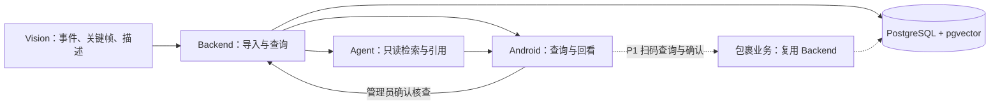

# 开发模块设计

按业务功能拆分需要开发的模块，关联实现目录、数据库、API 和开发任务。四个代码目录承载以下功能，不因增加业务模块而新增独立服务。

**契约草案为 11 张表、28 个操作，其中首轮 23 个、P1 包裹 5 个。** 本地 development 默认提供 14 个 Backend 操作，显式启用 Agent 后提供 23／28；P1 包裹仍待开发。实际实现与验证不等于外部模型、部署或 D10 业务验收。字段以 [数据库 SQL](../database/schema.sql) 和 [OpenAPI](../api/openapi.json) 为准。

## 模块总表

| 模块 | 需要交付什么 | 实现与主责 | 主要表 | 当前 API 数／任务 |
| --- | --- | --- | --- | --- |
| [M01 · App 骨架](#m01) | 四 Tab、导航与页面状态 | Android · 李果钦 | 经 API 使用数据，不直连 DB | 0／D02、D08 |
| [M02 · 账号与配置](#m02) | 当前用户、固定镜头与区域配置 | Backend · Harry Xu；Android／Vision 调用 | `users`；配置文件 | 2／D01、D05 |
| [M03 · 视觉产物与视频入库](#m03) | 真实事件包、关键帧、完整包导入与录像元数据 | Vision · 徐泽华；Backend · Harry Xu | `recordings`、`events`、`evidence` | 3／D03–D05 |
| [M04 · 事件与证据](#m04) | 条件查询、候选、事件详情与关键帧回看 | Backend · Harry Xu；Android · 李果钦 | `recordings`、`events`、`evidence` | 4／D05、D08 |
| [M05 · 语义检索](#m05) | 事件描述向量入库、同模型空间检索 | Backend · Harry Xu；Vision 交接编码；Agent 调用 | `event_embeddings`、`events`、`evidence`、`recordings` | 2／D04、D05、D07 |
| [M06 · AI 会话与分析](#m06) | 聊天、修改计划、执行／停止、引用与历史 | Agent · 韩广宁；Backend 协作存储；Android 展示 | `conversations`、`messages`、`runs` | 8／D07、D08 |
| [M07 · 人工核查](#m07) | 确认保存、历史列表和重启回读 | Backend · Harry Xu；Android · 李果钦 | `review_records`；关联 `users` 与事件证据 | 3／D09、D10 |
| [M08 · 首页与简报](#m08) | 活动概况、待核查线索与带引用的简报 | Android／Backend／Agent | 从视频、事件、关键帧与核查记录派生 | 0，汇总接口待评审／D10 |
| [M09 · SDK 验证](#m09) | 官方登录、设备、事件与媒体能力实测记录 | Harry Xu · 独立验证支线 | 暂不导入首轮事实表 | 官方 SDK，非团队 API／D06 |
| [M10 · 包裹入出库](#m10) | 建档、二维码、扫码查询、人工确认与流水 | Backend／Android；Agent 只读 | `parcels`、`parcel_records`；操作人关联 `users` | 5／P1，D10 后 |

以上表列表描述业务数据关联，不表示调用方直接访问数据库。认证身份统一映射到 `users`，不在每项读取中重复列出。详细字段见 [数据库说明](../database/README.md)，接口参数与模拟样例见 [API 设计](../api/API_DESIGN.md) 和 [v0.3 样例](../api/examples/v0.3/)。

## 模块交接

Backend 使用 Python + FastAPI，独立 Agent 包通过 `create_agent` 接入同一应用；Vision 继续由独立 Python 工作进程生成结果包，Android 使用 Kotlin + Compose。本地媒体存入受限目录，数据库保存引用；对象存储和正式部署另行配置。安装与启用见 [Backend README](../../backend/README.md)，工具边界见 [Agent README](../../agent/README.md)。

## M01 · Android App 骨架与导航

- **开发内容：** 四 Tab 骨架；候选、事件、帧和 AI 引用的选中状态；加载、空结果、无覆盖、失败与返回恢复。业务页面按 M04、M06、M07 接口实现，不为每个页面新增表。
- **数据／API：** 本模块不提供 API，不直连数据库；使用后端与 Agent 接口。工程准备见 [Android README](../../android/README.md)。
- **依赖与验收：** D01 范围确认后做 D02；协议冻结后按共享样例推进 D08。真机可往返导航，引用跳到同一事件；样例可用不等于真实闭环完成。

## M02 · 当前用户与区域配置

- **开发内容：** 将认证主体映射到用户，校验启用状态与资源权限；读取不可变版本的摄像头、区域与 ROI 配置。当前没有注册、用户管理或设备管理 API。
- **数据：** 读取 `users`；摄像头／区域放版本化配置文件，不增加 `cameras / zones` 表。SDK 凭据不保存到用户表。

| 当前 API 草案 | 提供方 → 调用方 | 数据关联 |
| --- | --- | --- |
| `GET /api/v1/user` | Backend → Android | 读 `users`，身份由认证主体确定 |
| `GET /api/v1/configs/{config_version}` | Backend → Android／Vision | 读配置文件，不读写业务表 |

**依赖与验收：** D01 确定配置、身份及权限约定，D05 实现；返回当前本人，非法／未知配置明确报错。认证实现仍待确定。

## M03 · 视觉产物、完整包入库与录像元数据

- **开发内容：** Vision 完成素材与人工基准、检测／匿名跟踪、区域事件和真实关键帧；Backend 校验并原子导入完整 `Recording + Event + Evidence` 包，提供已发布录像的列表与元数据。
- **数据：** Backend 写 `recordings / events / evidence`；Vision 经授权导入作业交接，不直连 DB。媒体字节独立存储，表内保存存储键、状态和定位；向量走 M05。

[Backend／Vision 联动说明](BACKEND_VISION.md) 汇总视觉分工、表读写、完整包与媒体上传、描述向量 API、重试和验收要求；沿用既有契约，不新增视觉任务服务。

| 当前 API 草案 | 提供方 → 调用方 | 数据关联 |
| --- | --- | --- |
| `POST /api/v1/recordings` | Backend → Vision 导入作业 | 完整包写 `recordings / events / evidence` |
| `GET /api/v1/recordings` | Backend → Android | 读 `recordings` |
| `GET /api/v1/recordings/{recording_id}` | Backend → Android／Agent | 读 `recordings` |

**依赖与验收：** D03 准备真实素材，D04 产出，D05 导入；固定输入可重复生成，事件／帧可回到源视频，重试不重复入库，失败不发布半包。这三个接口不是源视频回放入口，源视频字节接口仍待评审。

## M04 · 事件查询与关键帧证据

- **开发内容：** 区域／时间条件查询，候选与事件详情，真实关键帧读取；Android 联动路线观测点、时间线和帧，Agent 通过只读工具查事实。
- **数据：** 联读 `recordings / events / evidence`。当前同视频 `track_key` 聚合实际离散点，不补出连续轨迹或跨镜身份，不另建轨迹表。

| 当前 API 草案 | 提供方 → 调用方 | 数据关联 |
| --- | --- | --- |
| `GET /api/v1/events` | Backend → Android／Agent | 联读录像、事件、关键帧 |
| `GET /api/v1/events/{event_id}` | Backend → Android／Agent | 读事件及所属录像／关键帧 |
| `GET /api/v1/evidence/{evidence_id}` | Backend → Android／Agent | 读关键帧元数据与归属 |
| `GET /api/v1/evidence/{evidence_id}/media` | Backend → Android／Agent | 验证归属与状态后读实际图片字节 |

**依赖与验收：** D05 提供接口，D08 接页面，真实输入来自 D04。查询仍限定一个 `recording_id + camera_id + zone_id`；视频偏移窗口与 UTC 窗口二选一，UTC 要求非空 `started_at`。范围外、范围内未检出、媒体失效和服务错误分别反馈，候选／帧／引用 ID 一致。

## M05 · 事件描述向量与语义检索

- **开发内容：** 生成可追溯的事件／关键帧描述，按统一模型和编码版本交接向量；Backend 校验并入库，以授权范围和相同模型空间检索；Agent 回查候选与真实证据。
- **数据：** 写 `event_embeddings`；关联 `events` 及可选的同事件 `evidence`，筛选范围来自 `recordings`。pgvector 与业务表同库，模型、版本、维度和描述来源必须明确；实际模型空间由私有配置指定，外部编码效果仍待验收。

| 当前 API 草案 | 提供方 → 调用方 | 数据关联 |
| --- | --- | --- |
| `POST /api/v1/event-embeddings` | Backend → Vision 授权编码／导入作业 | 写 `event_embeddings`，校验用户、录像、事件与帧 |
| `POST /api/v1/events/search` | Backend → Android／Agent | 只读联查向量、事件、关键帧与录像 |

**依赖与验收：** D04、D05 交接，D07 用只读工具调用；事件证据入库后，可与 M07 并行开发。先精确检索，再按实测决定 ANN 索引；相似度只排序候选，未索引与无匹配分别返回，模拟向量不计入真实效果。

本地两个向量操作已实现，并使用真实 PG 检查同空间检索、幂等与索引缺口；HTTP 测试编码器明确为 mock，仅用于 mock 录像。未配置真实编码器返回 503，不把外部故障伪装成空结果；实际命令见 [D07 验证](../../openspec/changes/d07-create-agent/verification.md)。

## M06 · AI 会话、计划、分析与历史

- **开发内容：** 本人会话与消息，问题转可修改计划，按确认计划运行／停止，返回引用并回读聊天与分析状态；模型与配置来源可追溯。
- **数据：** Agent 与 Backend 协作写 `conversations / messages / runs`。会话不固定录像，每次运行仍限定一份录像；读取事实经后端只读工具，历史权限与引用归属依当前授权校验。

[Backend／Agent 联动说明](BACKEND_AGENT.md) 对应当前权限 Gateway、历史事务、显式路由、运行／停止／重启实现；公开 API 和表保持当前草案。模型仅经五个只读工具读取元数据／描述，不直连数据库，也没有把关键帧字节交给 VLM 看图。

| 当前 API 草案 | 提供方 → 调用方 | 数据关联 |
| --- | --- | --- |
| `GET /api/v1/agent/conversations` | Agent → Android | 读本人 `conversations` |
| `POST /api/v1/agent/conversations` | Agent → Android | 写 `conversations`，核对本人身份 |
| `GET /api/v1/agent/conversations/{conversation_id}/messages` | Agent → Android | 读 `messages`；经会话、运行及事实归属校验 |
| `POST /api/v1/agent/conversations/{conversation_id}/messages` | Agent → Android | 写本会话的用户问题 `messages` |
| `POST /api/v1/agent/plans` | Agent → Android | 读问题、会话及本次录像；计划草稿不另存表 |
| `POST /api/v1/agent/runs` | Agent → Android | 写确认计划／状态到 `runs`，完成时原子写答复 `messages` |
| `GET /api/v1/agent/runs/{run_id}` | Agent → Android | 读 `runs`，校验本次录像与事件／帧引用 |
| `POST /api/v1/agent/runs/{run_id}/stop` | Agent → Android | 更新非终态 `runs`，仍先验权 |
| `GET /api/v1/agent/runs/{run_id}/events` | Agent → Android | 读 `runs` 推送 SSE；快照先行，终态提交后推送卡片包（completed 落库、stopped/failed 合成状态卡） |

**依赖与验收：** D07 已有本地独立包和可选九个路由，实际图使用显式 fake 模型、历史／终态使用真实 PG 测试，凭据见 [D07 验证](../../openspec/changes/d07-create-agent/verification.md)。完成答复只保存一份；停止或失败不伪造答复，单执行器重启将旧 running 标为 failed／service_restarted，不自动续跑。外部 LLM／Embedding、真实视频业务及 D08／D10 App 联调仍待验收；流式进度与逐工具步骤历史尚无 API 契约。

## M07 · 人工核查与记录回读

- **开发内容：** 管理员针对一个事件选择决定、填写说明并显式保存；历史列表、详情和重启回读恢复原查询与决定。
- **数据：** 写 `review_records`，关联操作人 `users` 与 `events`，回读时联查录像／关键帧；核查记录与原事件分别保存，记录只追加。Agent 不调用保存接口。

| 当前 API 草案 | 提供方 → 调用方 | 数据关联 |
| --- | --- | --- |
| `POST /api/v1/review-records` | Backend → Android | 写 `review_records`，校验用户及事件／证据范围 |
| `GET /api/v1/review-records` | Backend → Android | 读核查记录及关联事件／录像 |
| `GET /api/v1/review-records/{review_id}` | Backend → Android | 联读核查、事件、录像与当前关键帧状态 |

**依赖与验收：** D09，服务依 M04，App 表单可先接样例；D10 验证真实事件保存、重试和 App／服务重启回读。当前只保存单事件，不把它当作整段多事件留档。

## M08 · 首页概况、待核查与 AI 简报

- **开发内容：** 汇总已导入范围的活动、媒体缺口和待核查线索；生成带有效引用的简报，点击可回到事件。属于 D10 首轮展示，需实际实现。
- **数据／API：** 从 `recordings / events / evidence / review_records` 派生，暂不新增摘要表；可先组合已有查询。`GET /api/v1/overview` 仍是建议接口，参数与返回尚未写进 OpenAPI；简报也没有独立已定义接口。
- **依赖与验收：** M04、M06、M07 联调后补齐；范围、计数与引用可核对，不能把未导入录像解释为全站无采集或无活动。

## M09 · 官方摄像头 SDK 独立验证

- **开发内容：** Harry Xu 在官方 Android 底座与设备上分别验证鉴权／登录、设备列表、事件查询、缩略图、直播、回放、下载和时间定位，记录 SDK／设备版本及成功或失败证据。
- **数据／API：** 官方 SDK／API 不计入团队 27 个接口；官方检测事件与团队视觉动作事件分开。首轮暂不写官方事件到现有事实表，后续导入方式与时间转换须先验证。
- **依赖与验收：** D06 需要设备、账号与 SDK 环境；独立推进，不阻塞预录素材的 D10。SDK 具备接口不等于真机已接通，缩略图不证明连续轨迹。

## M10 · P1 包裹二维码、扫码与入出库

- **开发内容：** Backend 建档与精确查询；Android 生成／解码二维码并展示状态，管理员确认入／出库；Backend 校验状态与幂等，保存有序流水；Agent 只读历史。
- **数据：** `parcels` 保存文本单号，`parcel_records` 保存管理员流水并关联 `users`。二维码由单号生成，不另建表；状态／位置从最大 `sequence_no` 派生，包裹流水不自动关联视觉事件。

| 当前 API 草案 | 提供方 → 调用方 | 数据关联 |
| --- | --- | --- |
| `POST /api/v1/parcels` | Backend → Android | 写 `parcels`；返回流水派生状态 |
| `GET /api/v1/parcels` | Backend → Android／Agent | 按 `parcel_no` 精确联读包裹／流水 |
| `GET /api/v1/parcels/{parcel_id}` | Backend → Android／Agent | 读包裹及派生状态／位置 |
| `GET /api/v1/parcels/{parcel_id}/records` | Backend → Android／Agent | 按序号读 `parcel_records` |
| `POST /api/v1/parcels/{parcel_id}/records` | Backend → Android | 管理员确认后写流水，操作人与时间由后端设置 |

**依赖与验收：** D10 主闭环验收后，按建档／查询 → 二维码／扫码 → 人工确认／流水 → Agent 只读历史推进。保留单号前导零，重复扫码不写流水，重试不重复追加，入库／出库／再次入库顺序和重启回读可核对；详细约定见 [包裹设计](../database/PARCEL_DESIGN.md)。

## 接口与扩展边界

当前 OpenAPI 共 27 个操作，字段和请求／返回定义不在本页复制。[模块 API 映射](../api/api-module-map.json) 记录提供方、调用方及各 API 的完整读写表，包括归属校验；[功能对照](../api/FEATURE_DATA_API_MAP.md) 从功能反查数据需求。

以下五个接口只在现有映射中标为 `proposed`，尚无 OpenAPI 契约，不计入 27 个：

| 建议接口 | 关联模块 | 数据来源 |
| --- | --- | --- |
| `GET /api/v1/cameras` | M02 | 固定配置文件 |
| `GET /api/v1/zones` | M02 | 固定配置文件 |
| `GET /api/v1/overview` | M08 | 录像、事件、证据及核查记录聚合 |
| `GET /api/v1/recordings/{recording_id}/tracks/{track_key}` | M04 | 同录像／匿名 track_key 的事件与实际帧点 |
| `GET /api/v1/recordings/{recording_id}/media` | M03／M04 | `recordings.storage_key` 指向的源视频字节 |

另外需评审 AI 运行列表 `GET /api/v1/agent/runs?conversation_id=...`，用于重启后找回失败、停止或未完成运行；它仅在设计说明中提出，未纳入以上五个建议或 OpenAPI。消息历史不能找回所有运行。

持续直播分析、跨镜关联、电商订单关联、Web 桌面查阅和多事件分组留档后续另评审；当前不扩张表或 API。开发前同时更新模块设计、DB／API 定义及样例，依赖与验收继续统一维护在 [开发计划](../DEVELOPMENT_PLAN.md)。

D05／D09 原 12 个基础数据操作的说明和凭据保留在 [Backend README](../../backend/README.md) 与 [D05 记录](../../openspec/changes/d05-backend-mvp/verification.md)。当前增加向量两个操作和显式启用的 Agent 八个操作，验证见 [D07 记录](../../openspec/changes/d07-create-agent/verification.md)；外部模型、真实视觉、Android 和 D10 仍按工作包分别验收。
