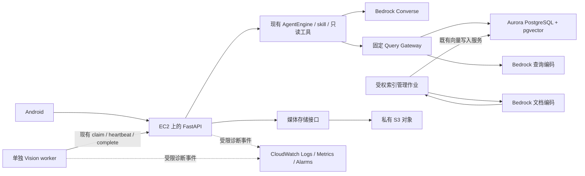

# Design

## Context

动机与范围见 [proposal.md](proposal.md)。本文是 2026-10-17 的设计稿，以下新增入口、配置、云资源和命令均为拟实现，不表示已存在。仓库有多人未提交修改；本轮仅新增本 change 的规划文件。

| 已观察的接缝 | 当前行为 | 设计约束 |
| --- | --- | --- |
| `backend/ai/providers.py`、`core/settings.py` | ChatOpenAI／OpenAI 兼容 Embedding，均要求 API key | Bedrock 单独分支；不能只改 base URL，不能让旧 key 检查阻挡 IAM 模型 |
| `agent/engine.py`、`tools/skills.py` | `create_agent`＋ToolStrategy、三项 skill、五个只读业务工具、引用账本 | 模型替换不改变工具权限、计划范围、结构化返回和停止语义 |
| `backend/services/semantic.py` | 查询侧 `encode(text)`；已有向量写入、同空间精确检索，无描述编码作业 | 同时增加文档编码、有限索引与新旧空间切换 |
| `backend/storage/media.py` | 本地暂存与目录 rename，PreparedMedia 配合 SQL 发布／回滚 | S3 不能模拟整包原子 rename；COMMIT 结果不明时保留对象 |
| `services/facts.py`、`services/recording_jobs.py` | 本地 Path、媒体解码、原片哈希；部分存在性判断吞 ApiError | 需要存储接口及错误分类；存储故障不能伪装缺图 |
| `vision/worker.py` | HTTP 下载不跟随重定向，租约／心跳／幂等完成 | 一期保留媒体代理，保持当前协议 |
| `backend/ai/runtime.py` | 单数据库／schema 独占执行锁，tasks／push／失败重试在内存 | EC2 单执行器；升级交接不使用双实例滚动抢占 |
| `storage/credentials.py`、Aurora overlay | 仅 EC2 IMDSv2 的 RDS IAM；模板 TLS 为 require | 云模型／对象用 SDK 身份；数据库升为 verify-full 并验证 CA |
| `vision/gallery_publication.py` | 本机 flock、CURRENT 原子切换、绝对 profile_root | S3 不承接图库文件锁；A 暂保持单图库发布者 |

配置背景中的旧表／API 数量和“没有运行服务”已落后于本地代码；不据此判断实际部署。HTTPS 历史验证记载过远端基础 API／Aurora，Backend README 仍写联调未执行，两者不代表当前服务状态。G0 按实际部署清单重新核对，不重复创建或初始化既有数据库。

## Goals / Non-Goals

**Goals:**

- 用同一受限 Agent 引擎调用真实 Bedrock，并完整建立“已发布事件描述 → 文档向量 → 查询向量 → 回查引用”的链路。
- 将录像和证据脱离单机磁盘，保留当前媒体 API 的权限、返回和 worker 行为；使发布与故障处理可验证。
- 让一次请求、异步 run 和视频 job 的失败能够关联定位，CloudWatch 不接收问题、证据或凭据正文。
- 每阶段可独立启用、暂停和回滚，以真实依赖与同一真实事件完成一期验收。

**Non-Goals:**

- 本轮不创建资源、不改生产配置、不运行付费模型请求。实施任务默认先离线，再使用明确选定的测试资源验证。
- 一期不新增业务表、公开路径或卡片字段；不改 Android 请求合同，不自动上传原片给 VLM，不把向量检索等同于看图或动作验真。
- SQS、AgentCore、直接预签名下载、多实例执行、在线自动 GC 与图库分布式发布只设计后续进入条件，不纳入本 change 一期实施。

## Decisions

### 1. 目标结构与模块责任



Backend 主责 provider 工厂、身份／存储、索引服务、历史及部署组合；Agent 仅依赖模型与只读 Gateway，新增可选受限事件 observer，不导入 AWS／数据库实现。Vision 仍以现有 HTTP 协议领取和交接，不直接写 Aurora。Android 一期仍使用原 URL、Bearer 与相同 DTO；现有认证机制不因 AWS 角色而变成正式多用户认证。

`BackendService.authenticate` 当前对非 development 环境明确返回 `auth_unavailable`。因此一期 G1–G4 使用明确标注的受控 development 演示环境与已有可撤销业务凭据，不为启用 AWS 放宽该保护。目标若是正式 staging／production，必须先由独立身份变更接通受信任身份系统；本 change 不通过改环境名称或添加绕过开关宣称生产就绪。

替代方案：将编排整体迁至 Bedrock Agents／AgentCore 会同时改变执行与权限边界，本期保留已测试引擎；向量继续使用 pgvector，不额外引入 OpenSearch 或 Knowledge Bases。

### 2. 配置、身份与资源定义

拟新增配置由 `backend/core/settings.py` 验证，所有值来自受控服务端环境：

| 配置组 | 拟定义的字段／语义 |
| --- | --- |
| 模型选择 | `PARTRACE_AGENT_PROVIDER`、`PARTRACE_EMBEDDING_PROVIDER`：`openai_compatible` 默认，或 `bedrock`，两者可分开切换 |
| Bedrock Chat | 独立 region、target（模型 ID／允许的 inference profile ARN）、受控 alias、模型修订、最大输出 tokens；长 ARN 不塞进旧 `agent_model` 的 100 字符限制 |
| Bedrock Embedding | 独立 region、模型 family／ID、固定 revision／recipe／维数；拒绝未实现的 family／维数组合 |
| 媒体 | `PARTRACE_MEDIA_BACKEND=local|s3` 默认 local；S3 region／bucket／prefix、受限本地 staging、连接／读取超时；DB 只保存原逻辑 key |
| 监控 | 日志格式／级别／轮转上限、部署版本、环境与稳定模型 alias；CloudWatch 组、保留期、告警阈值作为基础设施参数 |

启动只做配置一致性检查，不触发模型付费调用，不自动选最新模型。新 provider 由 Backend 安装兼容的 `boto3`／`botocore`／`langchain-aws`；实施时核定版本，更新 `backend/uv.lock`、导出的 `backend/requirements.lock`，校验镜像与打包白名单。Agent 包保留框架协议，不新增 AWS 强依赖。

AWS 服务使用 SDK 标准凭据链，部署限定 EC2 instance profile 临时凭据；本地显式 profile／SSO 或 SDK 替身。云端禁用长期 AK/SK 注入，不把 RDS token 签名器复用于 Bedrock／S3。IMDSv2 required；从实际容器中验证取证和刷新，不能以宿主成功替代。RDS 工厂的一期 EC2 限制保留，ECS／AgentCore 身份链留到二期。

拟新增 `infra/aws/template.yaml`：只声明私有 S3 bucket、日志组、指标／告警和可附加到既有角色的最小策略，不创建或替换 EC2／Aurora。资源参数包含环境、账户、区域、现有角色、DB 用户资源 ARN 和允许的模型／bucket prefix。资源标签包含 project／environment／owner。采用 CloudFormation change set 审阅实际影响；本轮不创建 stack。

权限按实际目标分别限制模型 invoke、指定对象 prefix 的读写、日志流写入及应用用户 `rds-db:connect`。S3 对象动作限定对象 ARN，清点／GC 的 `s3:ListBucket` 使用 bucket ARN 并按允许的 prefix 限制；验证实际策略下缺对象的可判定性。Head／Get 返回 403 不能推断不存在，只有受权操作确证无对象才按缺失处理，其他拒绝保持 503。应用角色不用 master postgres；schema 迁移使用独立管理权限。跨区 inference profile 默认不启用；确需使用时，部署清单必须列出涉及区域、底层模型 ARN、IAM／SCP 与数据处理范围。不能只给 profile ARN 就假定所有调用权限齐全。

### 3. Bedrock Chat 保持现有工具和结构化语义

`make_engine` 按 provider 创建 `ChatBedrockConverse` 或现有 ChatOpenAI，再交同一 `AgentEngine`。Bedrock 不检查 OpenAI key；原 provider 的模型／key 条件保持。`DraftPlan` 虽无业务工具，ToolStrategy 仍会增加结构化输出工具，因此模型上线验收必须同时覆盖计划工具与“业务工具＋CandidateAnswer”。

保留 `handle_errors=False`、固定 scope／query_text、skill 白名单、引用双回读、确定性卡片和停止后禁止完成。验证 tool_use／tool_result ID、多轮、并行工具批次和结构化返回；不以 provider 原生 JSON 输出绕过现有合同。

延续当前每 run 模型 8 次、工具 12 次、总超时 60 秒及并发 2 个，SDK 内部重试显式设为不自动重试，连接／读取超时受总预算约束；后续需要重试时另有显式预算。同步 SDK 移入有界线程池，取消会阻止新调用与迟到提交，但不宣称能撤销已被 AWS 受理的请求／计费。observer 只接安全阶段、耗时、计数、usage 和诊断 ID，不接提示词或结果正文。

`runs.model_key` 仍是现有文本字段，改用 provider＋region＋受控 alias／修订＋配置摘要，保持历史服务现有的 200 字符上限，实际长 target 保存在受控部署清单。运行开始固定模型配置，新配置仅作用于新运行，不在中途切模型。

聊天 IAM 拒绝、模型不支持工具、限流、超时、畸形响应等保留安全失败，不生成模拟答复；内部记录受控分类和 AWS request ID。语义可用性错误走既有 `503/model_unavailable → ToolUnavailable` 路径，权限／数据库／对象存储错误不能被吞成可选模型故障。

### 4. Embedding 必须包含两端编码和可恢复索引

将 `TextEncoder` 的意图分为 `encode_query` 与 `encode_document`；旧 OpenAI 适配器两者复用原 transport。第一版 Bedrock 实现固定为 Cohere Embed v4 的文本检索协议，query／document 分别对应 `search_query`／`search_document`；具体可调用 target ID、region、维数及相关性阈值在部署前验证。所选环境无法调用时停止该阶段，不自动换模型。Titan／Nova 等不同请求 family 另行扩展，不在一期并列实现或假定其中文效果。

空间键保持现有 `(model_name, model_version, dimensions)`。name 表达 provider／固定基础模型；version 包含模型修订与 recipe 指纹（描述模板、两端 input type、长度／规范化／归一化规则和维数）。更改任意编码语义建立新空间，不能复用通用 `v1`。查询使用一个激活空间，保持 SQL 的同空间物化筛选，旧向量不混入 cosine 算子。

拟新增 `backend/services/event_indexing.py` 与 `backend.manage index-event-descriptions` 管理入口，参数为 recording ID、目标空间、有限 limit／batch／并发和 dry-run；该命令不属于 Agent 工具，不接任意 SQL。业务 Bearer 从专用的受保护文件读取（拟配置 `PARTRACE_INDEX_TOKEN_FILE`，0600、受控所有者、禁止符号链接），不放 CLI 明文参数、不以 `--user-id` 构造管理员，也不以 IAM／数据库身份替代业务授权。每批读取／编码前及写入前均通过现有认证入口重新认证并验证 `data:ingest`、用户状态和录像权限；缺少或失效凭据就拒绝。编码期间不持有数据库事务，写入前回读来源摘要并复用 `SemanticService.insert_embedding` 的数值、归属和并发校验。

文档来源为已发布事件的现有 summary 和确定性来源／时间模板，保留 candidate、mock／manual／automatic、未知身份和未做模型复核标记。事件描述默认 `evidence_id=null`，不能复制成多帧各自观测。超出模型输入上限先明确拒绝该项，不暗中截断；不调用 VLM 补造衣着、颜色、拿取或责任。

编码前查找同来源摘要与空间的既有向量，已存在就跳过，不重复付费编码；稳定来源标识、去重和既有唯一约束共同保证重跑不重复发布。并发竞争只有一份来源可写，冲突后回读同摘要的获胜记录，不能覆盖或以相同 ID 强塞略有差异的向量。失败保留真实已写子集，输出计数与失败列表；dry-run 不调用模型、不写库。

先在旁路新空间建索引并检查覆盖和中文相关性，再于部署边界切换查询配置。无向量时仍返回 `unindexed` 且不请求查询编码；无匹配、未索引、范围外和故障保持区别；部分覆盖仍有缺口卡。更换模型后重新标定 score 阈值，旧空间保留用于回滚。持续新事件第一版通过同一受控命令定期增量补齐，重启和重跑继续跳过已完成来源，不新增通用任务表。

### 5. S3 一期保留受权媒体代理

在 `backend/storage/` 定义内部存储协议及 local／S3 实现，支持受限读、存在性／完整性检查、私有临时 materialize 与 prepare／commit／rollback。替换 `resolve().open/read_bytes` 等本地 Path 假设；S3 实现不能返回伪本地路径。`facts`、任务原片下载、完成时原片复用及媒体 API 都通过同一接口。

DB key 仍为 `objects/<bundle_uuid>/<file_uuid>.<ext>`；bucket／prefix 只在服务端配置，既有 Event／Evidence ID 不变。媒体仍经现有 API 完成用户、录像或 worker 当前租约检查，保持当前 200 完整字节响应及内容类型；现有路由没有 Range／206 合同，一期不新增。worker 不跟随重定向，因此一期不用 S3 预签名 URL 替代响应。代理会增加 API 带宽和读取开销，先保障协议与撤权语义；直接下载需另行约定短时 bearer 链接和客户端行为。

沿用私有本地 staging 做上传大小、路径、ffmpeg／图片全解码与 SHA256 校验，原片复用继续验证已存 `video_sha256`。真实缺失／损坏可按现有媒体缺失语义处理；S3 AccessDenied、超时和 5xx 映射受控 503，修改当前吞所有 ApiError 的存在性判断，防止故障伪装成缺图。读取缓存以实际版本／校验值和大小失效，不能把 ETag 当 SHA256；不缓存凭据或签名 URL。

### 6. S3 发布与 SQL 一致性

选通用私有 bucket，启用 Block Public Access、TLS、服务端加密，初版采用 SSE-S3；若环境要求客户管理 KMS，必须单列 key 和角色策略并验证。最终对象使用随机不可变 key 和条件写入，已有不同内容的同 key 立即拒绝。

发布步骤：

1. 本地 prepare 完成解码／哈希，在任何长 SQL 事务外上传本次独有的全部对象，核验 SHA256 与大小。
2. `commit()` 成为“所有对象已齐全且可读”的屏障，不再执行 S3 rename；任何部分失败不得发布 DB 引用。
3. 进入原有事实事务，重新验权／租约／配置／去重，再写引用与发布状态；任务 completed 和完整事实仍在原事务提交。
4. 明确 SQL 回滚时，仅清理本次新对象；共享 SDK 原片和既有引用不在清理集合。清理失败记诊断，不能改写提交结论。
5. COMMIT 断连不能确认结果时保留对象；按原 recording／job／内容摘要重读确认。重放沿用既有幂等约束；不因丢失响应重复发布事件。

无需依赖对象 tag 在 DB 提交后及时变化来证明发布。最终对象不配置按年龄或“未标记”自动过期；Lifecycle 仅清理确证不属于已发布事实的临时前缀／未完成 multipart。默认 GC 只 dry-run。真实删除的一期操作协议是停止 API 与所有 worker 媒体写入进程，确认旧进程已退出、上传排空、相关 DB 会话／发布事务及 COMMIT 不明记录已核清；只有管理进程可访问该 prefix，缺任一维护证明则拒绝 execute。DB 可读后对 `recordings / recording_jobs / evidence` 全部引用（含 pending／failed 任务）做 mark-and-sweep、二次确认及精确删除清单。在线自动 GC 要另设持久上传意图和 fencing 协议，不能靠等待几天或改 tag 推断安全。

### 7. CloudWatch 记录安全事实和低基数指标

拟在 Backend 请求边界／运行控制和 Agent observer 输出单行 JSON；Vision 输出同一事件契约的阶段日志。统一字段：timestamp、level、service、environment、version、event、request_id，按需附 run_id／job_id／attempt／stage／outcome／error_code／duration_ms、固定 skill／tool 名、provider request ID。HTTP 使用路由模板，不记录真实 URL、query 或 body。

开始异步 run 时显式保存 origin request ID 到诊断上下文；失败时生成 diagnostic ID，同时用于日志和既有 `error.request_id`。ID 关联只属于诊断，不新增业务字段或改变 owner 校验。模型／工具耗时、调用计数、实际返回的 token usage 可记录，缺 usage 标 unknown，不能伪造为零。日志禁止包含 Authorization、租约／IAM token、DSN、签名 URL、问题、prompt、工具结果、事件描述、图片、向量、人物档案和私有路径；不直接输出异常原文或未脱敏堆栈。

宿主 CloudWatch Agent 采集受控日志文件／Docker 流，日志组由 IaC 预建。采集失联保留有界本地轮转，业务不阻塞；该阶段接受诊断日志在极端故障下丢失，不将其当作不可篡改审计。数据库继续负责 run／任务／人工记录的真实终态。

| 指标组 | 字段或维度选择 | 初始告警行为 |
| --- | --- | --- |
| API 请求／耗时／错误 | env、route_template、status_class；service 由日志组固定 | 连续 readiness 失败；低流量不以无样本当故障 |
| Agent 终态／时长／模型及工具调用 | 终态用 env／outcome／error_code；模型调用另用 env／model_alias／operation | 超时／失败率超过阈值且达到最小样本数 |
| 任务／租约／图库 | env、worker_role、固定 stage | 最老 queued 超阈值、过期租约、gallery_publication_pending |
| 主机／DB／执行器 | 原生资源维度、受控 service | 磁盘／暂存／连接饱和、执行锁丢失、待终结失败持续 |
| 采集健康 | env、service、collector | 专用心跳缺失按 breaching，业务低流量不误报失联 |

run／job／request／camera／user／worker ID、原始 model ARN 只作日志字段，不能作自定义指标维度。每条 JSON metric filter 最多三个维度，按表拆成固定指标，不把所有字段堆进同一个 filter。model_alias 在配置中固定并映射 provider。指标优先用有限维度的 JSON metric filters／固定 gauge，运维计数允许近似，业务 completed 指标只在 SQL 成功状态转换后发出，幂等重放不重新算成功。Vision 区分 backend_completed 和 gallery_published，推广失败保留 pending 并停止相应 worker。

staging 日志保留期候选 14 天、生产候选 30 天，实际随部署参数确认。告警阈值、日志大小／采样、输出 tokens、索引批量与上传上限都显式配置；上线前按区域报价计算模型、存储、请求、代理流量和监控费用。预算告警不是硬支出封顶。通知目标由部署者指定，本轮不向任何人员发送通知。

上述 staging／production 保留参数只为将来身份就绪后的模板预留；本期 development 验证可采用 14 天保留，不将资源标签或日志组命名等同于正式业务环境已开放。

### 8. 一期部署与二期进入条件

一期继续 EC2＋Compose，API `--workers 1`，保持独占执行器；Aurora 私网／安全组只允许应用来源，连接使用 `sslmode=verify-full` 和受控 RDS CA。签名使用真实数据库端点、用户和区域；错误 CA、主机名或身份即拒绝。IAM-only 是特定部署设置，不是 Aurora 默认承诺。

`auth.json`、配置 pins、cursor 签名 key 和 A 图库仍是持久本地状态，部署与恢复必须保留相应 EBS／备份，不因媒体搬 S3 就删本地状态。就绪探针继续关注数据库／pgvector，模型短故障不杀死整个服务；模型与媒体另有健康诊断和告警。

二期 SQS 选择“可丢失唤醒信号＋保留有界数据库轮询”：提交 job 后 best-effort SendMessage，worker 收信仅触发现有 claim，租约、attempt、心跳与终态仍由 DB 决定。DeleteMessage 表示已处理唤醒，不表示 completed；丢消息／重复／DLQ 不改业务状态。若以后取消轮询并承诺可靠通知，必须新增同事务 outbox＋dispatcher 的独立规格与迁移。SQS 自身不解决 A 图库的多主机锁。

AgentCore 后续可托管 LangGraph，但先独立设计按 run 的执行 owner／租约／fencing、跨进程停止与事件通知、工作负载身份、持久状态及临时磁盘。移除全局独占锁／内存 broker 的假设后再验收托管扩容。A 图库需不可变版本、共享元数据 CAS／fencing 和跨机可读路径；现有 flock／绝对 profile_root 保持单发布者直到另行迁移。GPU 视觉计算继续按实际 worker 资源选择，不预设 Fargate 能运行 GPU。

## Risks / Trade-offs

- [模型可调用却不支持当前结构化多工具链] → 以真实 DraftPlan、skill＋业务工具＋CandidateAnswer smoke 作为启用门槛，保留旧 provider。
- [SDK 请求取消后仍在远端运行] → 有界连接／读取与线程池、无自动重试、取消后不再调新工具／提交终态；费用只按实际 usage／AWS 账单核对。
- [中文描述不足或模型空间混用] → 先有真实描述样本，再测试相关性与覆盖；新空间旁路重建，不用生成向量补造事实。
- [S3 与 SQL 不能共同提交] → 先上传不可变对象、后发布引用、未知 COMMIT 保留对象，维护窗清理；接受受控孤儿存储成本。
- [媒体代理带宽／暂存增加] → 延续现有上传／解码上限与磁盘监控，按测量优化流式读取；不跳过哈希或权限换取速度。
- [可观测性含敏感资料／高基数费用] → 字段白名单与诱饵数据测试、固定维度／保留期，默认不启用外部完整模型调用内容日志。
- [远端版本与当前代码差异、全局锁或图库限制] → G0 固定 revision／image／schema 清单，停启交接，A 单发布者；不直接启用弹性副本。
- [云端角色可用但正式业务认证未就绪] → 一期保持受控 development 验证；非 development 保持拒绝，独立身份变更完成前不宣布生产上线。

## Migration Plan

| 阶段 | 可核对的交付与进入下一阶段条件 | 回退 |
| --- | --- | --- |
| G0 基线 | 实际部署 revision／image／schema／API／Agent 启用状态清单；角色、region、RDS TLS／CA、pgvector、备份／cursor 恢复验证；基础安全 JSON 日志 | 保留旧 digest 与配置；不初始化已有 DB |
| G1 模型 | 固定 SDK 锁文件；真实计划及工具链 smoke；新空间 dry-run→有限索引→覆盖／相关性→查询切换，保持模型来源可追溯 | Chat 回旧 provider；Embedding 成套回旧空间，保留新向量 |
| G2 媒体 | 先测试桶再实际 bucket；暂停录入／worker complete，排空在途，导出三表引用并去重；原 key 复制／校验全部大小和 SHA256，检查图片解码，生成迁移 manifest；全部通过后切 S3 | 写入恢复前可回 local；S3 已有新写时先反向补齐全部当前引用并校验，或保留能读 S3 的版本，不能直接换回旧目录 |
| G3 监控 | 日志可关联 HTTP／run／job；实际 log group、低基数指标、测试告警与恢复；采集故障演练 | 关闭远端采集保留有界本地日志；不关闭业务审计 |
| G4 同事件验收 | 真实原片／已发布区域事件→文档索引→Agent 引用→Android 开帧→人工保存→重启回读；另验停止／撤权／缺图／依赖失败 | 按故障阶段暂停新增运行或发布，保留原事实和历史；不以 mock 结果补齐 |

升级时停止接受新分析，排空或明确停止已有 run，确认 SQL 终态并停旧执行器释放 lease，再启动新版本；第二执行器仍应拒绝启动。不要在同一 schema 上运行两个 Agent 实例模拟滚动升级。实施后才更新模块 README／配置模板及交接文档；本次规划不改 SQL／OpenAPI，若实施扩大字段范围先修订并完成契约同步。

## Open Questions

以下是部署参数，不改变上述能力／任务拆分；在首次真实调用或资源变更前填入受控部署清单：

- 账户／区域、Bedrock 可用模型与推理目标、中文样本集、向量维数／recipe 标识、实际配额与月预算。优先与既有 Aurora 就近，但每项 region 仍显式配置。
- bucket 名／prefix、环境日志保留期、资源 owner、恢复窗口和告警接收目标；若需客户管理 KMS，补相应策略与测试。
- 远端 revision、TLS／CA、数据库应用用户和现有资源归属的实际核查结果；有冲突先停止对应切换，保留旧服务。

## Official References

2026-10-17 核对的官方资料；可用模型／区域／价格在实际部署前再次核对。下列说明能力，不证明本项目已接入。

- [Bedrock 工具调用](https://docs.aws.amazon.com/bedrock/latest/userguide/tool-use.html)：模型提出调用，应用可继续执行已有受限工具。
- [Converse API](https://docs.aws.amazon.com/bedrock/latest/userguide/conversation-inference.html)：统一消息与工具配置。
- [Cohere Embedding 参数](https://docs.aws.amazon.com/bedrock/latest/userguide/model-parameters-embed-v4.html)：query／document 输入类型与模型特定请求。
- [S3 条件写入](https://docs.aws.amazon.com/AmazonS3/latest/userguide/conditional-writes.html)：避免覆盖不可变对象；不提供 SQL 跨系统事务。
- [S3 HeadObject](https://docs.aws.amazon.com/AmazonS3/latest/API/API_HeadObject.html)：缺对象时的 403／404 取决于权限，不能由拒绝推断缺失。
- [S3 预签名访问](https://docs.aws.amazon.com/AmazonS3/latest/userguide/using-presigned-url.html)：临时 bearer 访问的适用边界，留作后续直接下载设计。
- [CloudWatch 日志指标过滤](https://docs.aws.amazon.com/AmazonCloudWatch/latest/logs/MonitoringLogData.html)与[维度选择](https://docs.aws.amazon.com/AmazonCloudWatch/latest/logs/FilterAndPatternSyntaxForMetricFilters.html)：日志指标与高基数费用约束。
- [SQS 可见性](https://docs.aws.amazon.com/AWSSimpleQueueService/latest/SQSDeveloperGuide/sqs-visibility-timeout.html)：消息可再次投递，业务幂等不能由队列配置代替。
- [AgentCore Runtime](https://docs.aws.amazon.com/bedrock-agentcore/latest/devguide/agents-tools-runtime.html)：支持 LangGraph 等框架，现有执行归属仍需独立迁移。
- [RDS IAM 连接](https://docs.aws.amazon.com/AmazonRDS/latest/UserGuide/UsingWithRDS.IAMDBAuth.Connecting.html)与[TLS／CA](https://docs.aws.amazon.com/AmazonRDS/latest/UserGuide/UsingWithRDS.SSL.html)：工作负载认证与数据库服务器身份验证各有条件，应用授权仍独立执行。

## Planning Validation

2026-10-17 实际执行规划检查：OpenSpec 1.14.1，现有 Node 22 运行本机已缓存 CLI，`OPENSPEC_TELEMETRY=0`；未安装依赖或调用 AWS 账户。

```sh
openspec validate --all --strict --no-interactive
openspec validate --archived --no-interactive
openspec status --change d05-d07-aws-integration
git diff --check
```

全量 13 项、既有归档 4 项均通过；本 change 规划状态 4／4。另检查全部 7 份 Markdown 的相对文件链接，无缺失；4 份规格共 31 条要求、54 个场景，任务为 0／42 完成。交叉评审已修正索引业务身份、S3 403／404、维护窗证明、当前完整字节响应及日志极端丢失边界。

这些结果只证明规划文件齐全与格式有效，没有运行业务测试、真实 Bedrock／S3／CloudWatch／Aurora、部署切换或 D10。保留本 change 活跃状态，实施任务全部未勾选；不归档、不改 Issue 状态、不发送通知。
